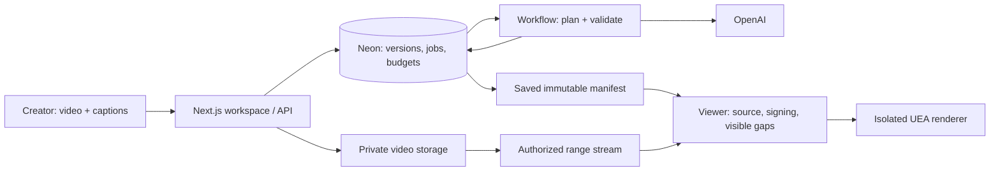

# SignBridge

[](https://github.com/Tayebbb/signbridge/actions/workflows/quality.yml)
[](https://github.com/Tayebbb/signbridge/actions/workflows/operations.yml)

**Bangla captions. Saved signing companions. Visible gaps.**

SignBridge pairs a short captioned video with sequential avatar signing. The source plays first, then holds while the avatar signs. Missing critical concepts block completion, and corrections produce a new saved track while older work is fenced out.

[Live application](https://signbridge-mdtayebibne-4755s-projects.vercel.app) · [Architecture](SYSTEM-DESIGN.md) · [Release verification](docs/HARDENING-REPORT.md) · [Operations](docs/OPERATIONS.md)

> Signing remains experimental and unreviewed. Rendering an animation does not establish correct BdSL or user comprehension. No qualified language review or comprehension study is claimed.

**Real-world test:** a 29-second Bengali interview with published captions produced **0 signing units across four segments**. Missing vocabulary and conservative validation blocked every segment. The browser-upload failure found during that test is fixed, but general-video signing is not ready. See the [normal-video test report](docs/NORMAL-VIDEO-TEST.md).

## What works

- Upload an MP4/WebM clip with Bangla SRT, WebVTT or timestamped captions.
- Preview and edit segments, build a companion, and follow source-first sequential playback.
- See unsupported concepts before signing; retry or skip incomplete playback without falsely counting it as complete.
- Reopen saved tracks without another model call. Publication and browser response fences reject stale work.
- Share a view-only link, revoke it, or delete the project. Every source-video request checks current authorization, including byte ranges.
- Save a creator recovery key and restore access after losing the browser cookie.

## Connected services

| Responsibility | Production | Local development / tests |
|---|---|---|
| UI and HTTP API | Next.js on Vercel, Node 24 | Next.js on loopback |
| Durable records and accounting | Neon PostgreSQL + Drizzle | PGlite; native PostgreSQL for contention tests |
| Source video | Private Vercel Blob through authorized streaming | Filesystem adapter |
| Meaning extraction and sign planning | OpenAI Responses with strict schemas and bounded reservations | Deterministic fake with labelled provenance |
| Background execution | Vercel Workflows with SQL outbox/run claims | In-process dispatcher using the same contracts |
| Avatar | UEA CWASA vhg2026 / Anna in an opaque sandbox | Real integration checks and an intercepted deterministic test engine |



The public application uses real production adapters. Fake fixtures are a local testing tool and are labelled in provenance.

## Public examples

- [Covered technical sample](https://signbridge-mdtayebibne-4755s-projects.vercel.app/s/b0a2b6b2-fbab-4936-829e-620b0a937ed4?s=8EdVJxY2BO-DDccdy6bQu-M7r5Oq5aSyH4ma9NaE6Fg): six isolated nouns in a 45-second clip.
- [Unsupported-concept sample](https://signbridge-mdtayebibne-4755s-projects.vercel.app/s/1ad052e9-bb09-4132-a98a-995917bfb86b?s=v-7iWygWd90ePqFdKQV4ZLu_9NGMwYCB9f-3bsllpVs): a blocking critical gap.

These use original silent synthetic source cards and real saved processing results. They are technical examples, not participant recordings or evidence of natural-language coverage. Their creator can revoke them, and operational limits apply.

## Run locally

Requirements: **Node 24**, **npm**, and a WebGL-capable browser. No API key is needed for the local fake path.

```powershell
git clone https://github.com/Tayebbb/signbridge.git
cd signbridge
npm ci
npm run db:migrate
npm run db:seed:local
$env:PROCESSING_ENABLED = 'true'
npm run dev
```

Open the loopback URL printed by Next.js. With `DATABASE_URL` unset, persistence uses PGlite and source files remain local under `.data/`. The migration script reads exported environment values rather than loading `.env.local` itself.

See [.env.example](.env.example) for every setting. Keep API keys, database URLs, owner/recovery capabilities, operational tokens and backups out of Git. Private environment files, `.data/`, `.vercel/` and dependency/build directories are ignored.

## Verify a change

```powershell
npm run typecheck
npm run lint
npm test
npm audit --omit=dev --audit-level=moderate
npm run test:race:native
npm run test:product
npm run test:e2e
npm run build
npm run check:secrets
```

Native tests require PostgreSQL binaries through `PG_TEST_BIN`; the Windows default is `C:/Program Files/PostgreSQL/16/bin`. They create disposable loopback clusters, never production connections. Browser checks need Playwright Chromium/Edge, WebGL and UEA access for real-engine integration. Install browsers with `npx playwright install chromium msedge`.

CI uses fake/local processing without model credentials. The separate operations workflow monitors and reconciles the live service using approved encrypted secrets. Exact results and boundaries are in the [release report](docs/HARDENING-REPORT.md).

The manual public-browser workflow verifies the saved production sample with the real remote avatar, including all six desktop segments and touch playback in mobile emulation. It uses no private credential and creates no processing job.

## Reliability and privacy

- Immutable manifests, SQL epochs/run claims and client refresh generations prevent old work from becoming current.
- Ordered unit checks, watchdogs and disposable iframe ownership prevent stale callbacks from manufacturing completion.
- Every real model attempt reserves spend first. Uncertain billing remains charged; deleting a project never refunds it.
- Metadata polling transfers no video bytes. Actual reads pass the monthly allowance, including pinned clips. Range reads reserve a conservative full-object upper bound.
- Creator cookies are host-only, Secure, HttpOnly, SameSite=Lax and valid for 180 days. Recovery keys are stored only as hashes; recovery invalidates previous creator sessions.
- Videos normally expire after 72 hours. Captions and manifests persist until project deletion. [Data lifecycle](docs/DATA-LIFECYCLE.md) explains cleanup, provider retention and recovery limits.

## Evidence and limits

| Category | Evidence |
|---|---|
| Technical renderability | Curated corpus/production replay, deterministic regressions, native SQL contention and browser integration checks. Exact current counts are in the release report. |
| Linguistic correctness | **None.** No qualified BdSL signer assessed these exact rendered versions. |
| User comprehension | **None.** No consented comprehension evaluation with Deaf/BdSL users. |

Production currently enables 12 hash-matched, technically probed assets. Conservative detectors, unsupported nonmanual features and composed sequences can produce blocked or unsuitable output. Automated gap checks, mobile emulation and accessibility scans do not replace qualified review, comprehension research or physical-device observations.

Clips are limited to 90 seconds, 15 MB and 20 segments. Free infrastructure and a small credit allocation impose capacity limits. UEA, WebGL and the configured providers remain runtime dependencies. See [limitations](docs/LIMITATIONS.md) and [operations](docs/OPERATIONS.md).

## Project map

| Path | Responsibility |
|---|---|
| `app/` | Pages, components and thin route adapters |
| `lib/domain/`, `lib/contracts/` | Pure validation, segmentation, retrieval and structured contracts |
| `lib/db/queries/`, `lib/db/migrations/` | Authoritative transitions, ledgers and schema changes |
| `lib/ai/`, `lib/jobs/` | Provider boundaries, metering and durable execution |
| `lib/player/` | Scheduling, isolation, event validation and client track state |
| `tests/` | Unit, API, PostgreSQL race and browser checks |
| `docs/phase-reports/`, `docs/evidence/` | Historical gates and dated evidence |

The original `phase-1` through `phase-8` tags are preserved. Later rechecks and hardening retain their historical meaning; design changes are recorded in [DEVIATIONS.md](docs/DEVIATIONS.md).

## Attribution

Sign data: **IsharaKotha v2**, **CC BY 4.0**. Renderer: the unmodified remote **University of East Anglia CWASA vhg2026 / Anna**, under its own terms. The official event sticker was supplied and confirmed by the owner; its original bytes are retained with responsive delivery optimization. See [ATTRIBUTION.md](docs/ATTRIBUTION.md) for provenance and prior work.
