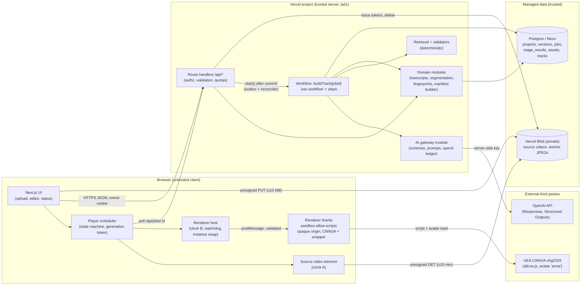
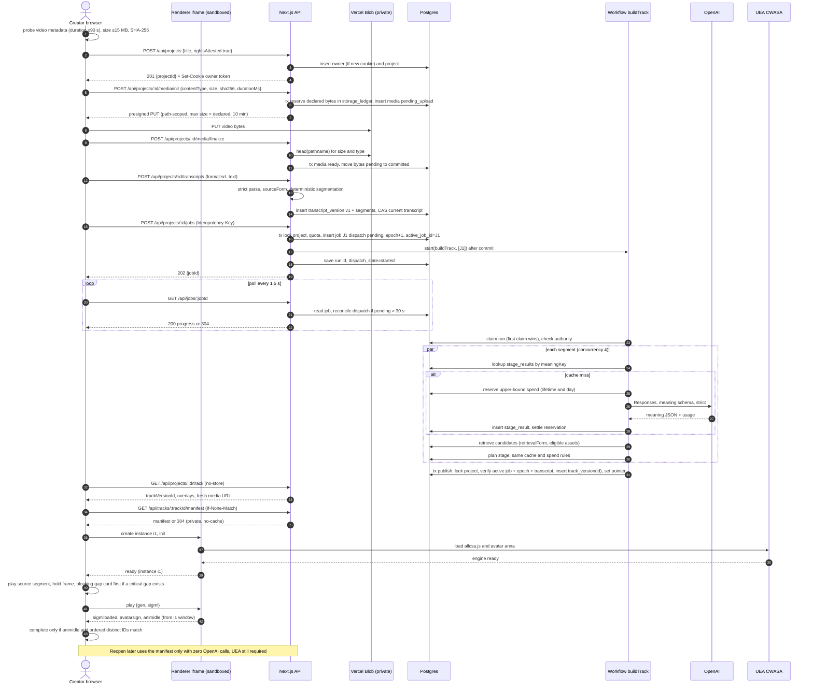
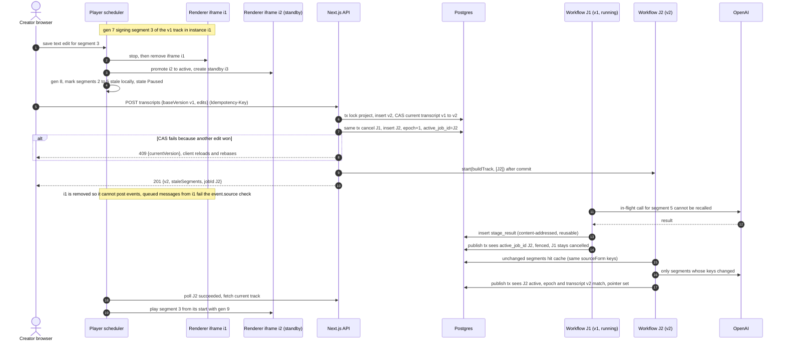
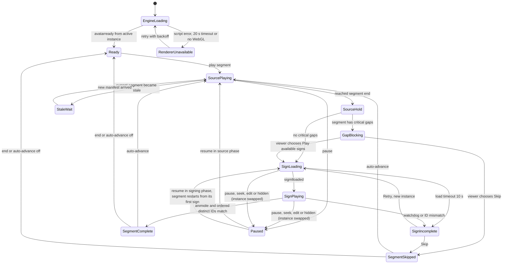

# SignBridge — Implementation-Ready System Design

*Version 1.1 · 3 November 2026 (Asia/Dhaka) · Lead architect draft for the YUNet AIgnite primary-round build · revised in place after `SYSTEM-DESIGN-REVIEW.md` (change log §0.4)*

SignBridge turns a short, creator-owned Bangla video plus a supplied SRT/VTT transcript into a **replayable, experimental BdSL avatar companion track**: each meaning unit is played from the source, the relevant source frame is held, the complete signing sequence plays in an unmodified UEA CWASA avatar using IsharaKotha v2 SiGML assets, and corrections to the transcript durably regenerate only what changed.

## 0. How to read this document

### 0.1 Evidence labels

Every material claim carries one label:

| Label | Meaning |
|---|---|
| **VERIFIED** | Read in official/primary documentation on 3 Nov 2026; URL given. |
| **TESTED** | Observed in our own local probes (files under `E:/AIgnite-Lab/research/2026-11-03-signbridge/`). Scope of the test is stated; it does not generalize beyond it. |
| **PROPOSED** | A design decision or algorithm in this document. Not yet built or measured. |
| **ASSUMPTION** | Reasonable working assumption used for sizing or planning; replace with real data when available. |
| **PROVISIONAL** | Depends on a fact that could not be fully verified (or may change); has a stated fallback. |
| **UNRESOLVED** | Open dependency that blocks or weakens a claim; listed in the closing section. |

### 0.2 Sources

| Key | Source (read 3 Nov 2026 unless marked) |
|---|---|
| [CWASA-HOOKS] | https://vh.cmp.uea.ac.uk/index.php/Logging_and_Event_Hooks |
| [CWASA-CFG] | https://vh.cmp.uea.ac.uk/index.php/Configuring_CWASA_for_HTML5_web_pages |
| [CWASA-TERMS] | https://vh.cmp.uea.ac.uk/index.php/CWASA_Conditions_of_Use |
| [CWASA-2026] | https://vhg.cmp.uea.ac.uk/tech/jas/vhg2026/ (engine used in local probes) |
| [CORPUS] | https://data.mendeley.com/datasets/6ykgx65ks5/2 (DOI 10.17632/6ykgx65ks5.2, CC BY 4.0; via local `data-audit.md`) |
| [OAI-PRICE] | https://developers.openai.com/api/docs/pricing |
| [OAI-SO] | https://developers.openai.com/api/docs/guides/structured-outputs |
| [OAI-STT] | https://developers.openai.com/api/docs/guides/speech-to-text |
| [OAI-SAFETY] | https://developers.openai.com/api/docs/guides/safety-checks |
| [VC-FN] | https://vercel.com/docs/functions/limitations (updated 2026-08-24) |
| [VC-WF] | https://vercel.com/docs/workflows (updated 2026-09-04) |
| [VC-WF-PRICE] | https://vercel.com/docs/workflows/pricing (updated 2026-09-16) |
| [VC-BG] | https://vercel.com/kb/guide/background-workers-on-vercel (published 2026-11-02) |
| [VC-BLOB-PRICE] | https://vercel.com/docs/vercel-blob/usage-and-pricing (2026-09-23) |
| [VC-BLOB-PRIV] | https://vercel.com/docs/vercel-blob/private-storage (2026-09-15) |
| [VC-SIGNED] | https://vercel.com/docs/vercel-blob/vercel-signed-urls |
| [NEON] | https://neon.com/pricing (updated 2026-10-31) |
| [W3C-SL] | https://www.w3.org/WAI/media/av/sign-languages/ (guidance reference; not re-read in this session) |
| [EVENT] | https://yunet-aignite26.devpost.com/rules (via local `competition-event.md`; not re-read in this session) |
| [REVIEW] | `E:/AIgnite-Lab/signbridge/SYSTEM-DESIGN-REVIEW.md` and its probes in `E:/AIgnite-Lab/research/2026-11-03-signbridge/system-design-review/` (`review-probes.cjs`, `probe-results.json`, `probe-results-lowercase.json`, `probe-results-diagram-fixes.json`): cross-file SiGML and Mermaid render checks executed 3 Nov 2026 |
| [OAI-REASONING] | https://developers.openai.com/api/docs/guides/reasoning (via [REVIEW]: `max_output_tokens` includes reasoning tokens; incomplete responses can still incur usage) |
| [LOCAL] | `E:/AIgnite-Lab/research/2026-11-03-signbridge/` — `SIGNBRIDGE-IMPROVEMENTS.md`, `data-audit.md`, `comprehension-product.md`, `competition-event.md`, `render-corpus-probe.cjs`, `render-corpus-results.json`, `local-origin-probe.cjs`, `local-origin-result.json`, `cwasa-inspection.json`, `canonical-id-derived.sigml`, `isharakotha-samples/manifest.json`, `isharakotha-v2-public-file-manifest.json` |

### 0.3 Non-negotiable honesty rules (apply to UI, deck, demo, and code)

1. All newly composed signing is labelled **"Experimental · not reviewed by a BdSL signer"** unless a qualified reviewer assessed that exact rendered version (§C.7).
2. A segment with an unresolved critical concept is never shown as complete; the gap is visible in the signing panel itself, not only in captions (§D.7).
3. We do not claim to have invented video-to-avatar (SignOLight) or text-to-avatar rendering (IsharaKotha research). Our claimed differentiation is the *working combination* of phrase-aware sequential playback, source-frame grounding, and corrections that durably update a companion track.
4. Renderability ≠ correctness ≠ comprehension (§H.3). Schema validity, dictionary lookup, model agreement, and backtranslation are not evidence of correct BdSL.
5. A watchdog timeout, a skip, or a unit-count mismatch is **never** reported as completed signing (§E.7).

### 0.4 Revision 1.1 change log (review findings → changes)

The v1.0 score of 9/10 measured checklist coverage only. It did not show that the SQL, the playback algorithm, the spend limits or the translation work. v1.1 fixes the correctness contracts and keeps the stack and scope. No scale infrastructure was added.

| # | Review finding | Change in v1.1 | Where |
|---|---|---|---|
| 1 | Lossy normalization in cache keys could merge question/statement, positive/negative, different numbers; cached outputs carried `segmentIdx` | Three explicit, versioned text forms: `sourceForm` (model-visible, conservative; the **only** form in keys), `phraseForm` (exact-phrase matching, keeps `?`/`!`/negation), `retrievalForm` (lossy, candidate lookup only). Stage outputs are position-independent (`meaning-v2`/`plan-v2` drop `segmentIdx`); positions are bound when the manifest is built. Counterexample tests T15. | §C.3, §D.4, §D.5, §F.2, §H.1 |
| 2 | Publication checked transcript version only; a cancelled job or a second job for the same transcript could publish | Project row carries `active_job_id` + monotonic `processing_epoch`. Start/retry/cancel/edit/delete/stall-fencing and publish all lock the same project row; publish requires active project, current transcript, active job, matching epoch, job running and not cancelled. Acceptance matrix T16. | §C.2, §F.3, §F.4, §F.6 |
| 3 | Track fingerprint omitted bindings inside the manifest; mutable endpoint had a one-year `immutable` header; manifest pointed at a media row | `trackFingerprint = H(manifest without its own id)`, so dedup can only return an identical artifact. `trackVersionId` is allocated and **explicitly inserted**. Source confirmation and review are mutable overlays outside the manifest. Media bound by content hash, not row. Current-pointer route `no-store`; versioned manifest route `private, no-cache` + strong ETag; no `immutable` anywhere in P0; no presigned URLs inside cached bodies. T17, T18. | §C.4, §F.2, §F.9, §G.1 |
| 4 | Uppercase gloss IDs (CWASA lowercases them); unscoped callbacks stamped with the current generation; 600 ms quiescing is not a barrier | Lowercase canonical IDs `g{gen}_s{seg}a{step}u{unit}` (TESTED 4/4 [REVIEW]). Completion compares **ordered distinct** IDs (terminal duplicate tolerated); a sign event marks a sign *start*. Ownership barrier = **disposable renderer instance**: any cancellation discards the CWASA iframe; a removed iframe cannot deliver events, and messages are filtered by `event.source`. Pause restarts the segment's signing from the start. Fake engine emits real unscoped payloads. T3, T7. | §E.1, §E.3, §E.5, §E.6 |
| 5 | Watchdog counted as completion; gaps shown after affirmative-looking partial signing | Watchdog/mismatch → `SignIncomplete` recoverable failure state (source held, Retry/Skip), separate telemetry. A segment with a critical gap shows a **blocking gap card before any signing** and holds auto-advance. T22. | §C.6, §D.7, §E.4, §E.5, §E.7 |
| 6 | DB commit → `start()` not atomic; 60 s lease < 90 s call | Outbox `dispatch_state`, idempotent reconciler (poll-, page-, and cron-triggered), run claim so duplicate starts are no-ops, stall fencing. Lease driver: 150 s lease + `lease_epoch` fencing, env-gated. T19. | §F.3a, §F.8 |
| 7 | Daily cap only, average-cost reservations, orphan reservations | Atomic **lifetime + daily** budgets; per-attempt reservations at a conservative **upper bound**; settlement on usage; uncertain billing retained as spent; reconciler; SDK retries off, attempt counter bounds retries. T20. | §A.5, §F.5, §F.7 |
| 8 | Storage gate raced concurrent uploads; retention cleanup unspecified; transfer uncontrolled | `storage_ledger` with atomic reservation of declared bytes at token issue; finalize/expiry reconciliation; scheduled + opportunistic cleanup with a stated bound (≤ 96 h); estimated-transfer gate that exempts pinned demo media. T21. | §A.5, §C.2, §G.3 |
| 9 | DDL lacked promised cascades; hard delete vs `deleted` status; "no personal data" claim | Soft fence (`deleting`) + idempotent purge with `ON DELETE CASCADE` children and `SET NULL` pointers; stage cache rows tracked by `stage_result_refs` and purged with the project; privacy wording corrected. T24. | §A2.1, §C.2, §F.6, §G.4 |
| 10 | Same-origin UEA script described as isolated | P0 runs CWASA in a `sandbox="allow-scripts"` iframe (opaque origin) with a validated `postMessage` contract (PROPOSED, must pass T23). If the engine cannot load there, the fallback is to **explicitly accept UEA as trusted same-origin code** for the prototype and say so. | §B.1, §E.3a, §G.4 |
| — | Two sequence diagrams failed to render (semicolons in messages) | Both rewritten without semicolons and with the corrected behaviour. | §B.2, §B.3 |

---

## A. Scope and architectural decisions

### A.1 Decision summary

| Concern | Decision (PROPOSED) | Why | Rejected alternatives |
|---|---|---|---|
| App runtime | **One Next.js (App Router) + TypeScript modular monolith on Vercel**, Node.js runtime, Fluid compute | One language, one deploy, server-side OpenAI key, Vercel is the target host. Hobby function max duration 300 s; request/response body 4.5 MB [VC-FN] (VERIFIED). | Python/FastAPI media worker: P0 does **no server-side media processing** (no ffmpeg, no ASR), so a second runtime buys nothing before the deadline. Revisit only if server-side transcoding/ASR becomes P0. |
| Durable async work | **Vercel Workflows** (Workflow SDK, `'use workflow'` / `'use step'`) orchestrating a per-job run; **Postgres `jobs` + `stage_results` remain the source of truth**. Dispatch from Postgres to Workflows is not atomic, so jobs carry an outbox `dispatch_state` and an idempotent reconciler (§F.3a) | Workflows is GA (April 2026), built on Vercel Queues + managed persistence, survives deployments and crashes via deterministic replay [VC-WF] (VERIFIED). Steps are retried; state is not in memory. | `waitUntil`/`after()` — not durable, no retries [VC-BG] (VERIFIED). Raw Vercel Queues — public beta [VC-BG]. Vercel Daemons — public beta, production-only [VC-BG]. Redis/BullMQ, Kafka, Inngest — extra vendor/infra with no added need. |
| Primary database | **Postgres (Neon via Vercel Marketplace), Drizzle ORM + drizzle-kit migrations** | Relational integrity for versions/jobs/reviews; JSONB for manifests and model outputs; CAS via conditional `UPDATE`. Neon Free: 100 CU-hours/project/month, 1 GB storage/project, autoscale ≤2 CU, scale-to-zero after 5 min (cannot be disabled on Free), 6 h history window [NEON] (VERIFIED). | Supabase (fine, but adds auth/storage surface we do not use); SQLite/Turso (weaker fit for concurrent job writes); a vector DB (corpus is ~4K small records; lexical retrieval + in-process scoring is enough). |
| Object storage | **Vercel Blob, private store**; browser uploads directly with a presigned/client token; playback through **short-lived presigned GET URLs** | Avoids the 4.5 MB function body limit for uploads and media delivery [VC-FN]; private stores require auth for reads [VC-BLOB-PRIV]; presigned GET tokens are time-limited (default 1 h, max 7 days) [VC-SIGNED] (VERIFIED). | Public blobs with random names (no revocation); streaming media through a Function (costlier and the 4.5 MB limit is a risk for 15 MB files) [VC-BLOB-PRICE]. |
| Progress delivery | **Short polling** `GET /api/jobs/:id` (1.5 s while active → 5 s after 30 s, `ETag`/`304`) | Stateless, survives function restarts and redeploys, trivially correct with CAS state in Postgres; job counts are tiny. | SSE: long-lived function connections tied to the 300 s duration limit, reconnect logic, no benefit at this scale. WebSockets: not native to Vercel Functions. |
| Identity | **Anonymous owner capability**: random 256-bit owner token in an `httpOnly; Secure; SameSite=Lax` cookie, only its SHA-256 stored. **Unlisted share links** with a separate random token. | Zero sign-up friction for judges; owner-only mutation; revocable share. | OAuth/email login: costs build hours, adds a dependency, no judged value. |
| Renderer | **Unmodified remote UEA CWASA vhg2026, Anna avatar**, loaded from `https://vhg.cmp.uea.ac.uk/tech/jas/vhg2026/` **inside a sandboxed, opaque-origin iframe; one disposable instance per cancellation boundary** (§E.3a) | Only path tested [LOCAL] (TESTED); engine must be used without modification on BY-ND-equivalent terms; example pages BY-SA; no warranty for software or UEA server [CWASA-TERMS] (VERIFIED). | Self-hosting, offline export, modified builds, evaluation avatars: not cleared. |
| Sign data | **IsharaKotha v2** only, imported offline into Postgres with derived ASCII-gloss SiGML; attribution retained | CC BY 4.0 [CORPUS]; other datasets' rights unresolved [LOCAL data-audit.md]. | Bangla-SGP, Breaking the Silence, Ban-Sign-Sent-9K: rights unresolved — not used. |
| AI | OpenAI Responses API with **Structured Outputs (`strict: true`)**, two stages per segment (meaning → plan), primary `gpt-6.1-sol`, fallback `gpt-6.1-terra` (§A2) | Structured outputs guarantee schema conformance, not correctness [OAI-SO] (VERIFIED). | Fine-tuning (§A2.3), multi-agent debate, LLM-as-judge as an accuracy claim, LLM-generated hand motion. |
| ASR | **Not in P0.** Supplied SRT/VTT or pasted timestamped transcript only. | `gpt-transcribe` is the recommended transcription model, but the guide's word-timestamp/subtitle examples use deprecated models (`whisper-1` etc., shutdown 26 Feb 2027) [OAI-STT] (VERIFIED); Bangla is not named in the fetched language section (UNRESOLVED). Timed captions are what the pipeline needs. | Promising ASR + timing alignment in 2 days; YouTube caption extraction (not permitted by embedding). |

### A.2 Deployment topology (deadline architecture)

```
Browser (creator / viewer)
  ├─ Next.js pages + client player (source <video> + CWASA panel)
  ├─ direct PUT/multipart upload → Vercel Blob (private)       [presigned, size/type-limited]
  ├─ media GET ← Vercel Blob CDN                               [presigned GET, ≤15 min]
  ├─ renderer iframe (sandbox=allow-scripts, opaque origin)
  │     └─ CWASA engine/avatar ← vhg.cmp.uea.ac.uk (UEA, third party) [no warranty]
  └─ /api/* → Vercel Functions (iad1, single region)
                ├─ Postgres (Neon, single primary, same region chosen at creation)
                ├─ Vercel Workflows run (steps = Functions) → OpenAI API
                └─ Vercel Blob control plane (token issuance, delete)
```

- **Region**: Functions default to `iad1` (single region) [VC-FN] (VERIFIED). PROPOSED: create the Neon project in the closest AWS region to the function region (us-east-1) to keep DB round trips ≈ same-region. Dhaka users pay one cross-continent RTT (~150–250 ms, ASSUMPTION) on API calls; media comes from the Blob CDN; the avatar comes from UEA (UK).
- **What survives a process restart / redeploy / timeout / duplicate delivery** (PROPOSED unless marked):

| Event | Survives | Mechanism |
|---|---|---|
| Function instance killed mid-request | All committed DB rows, all Blob objects, Workflow run state | Workflow step re-executed; step writes are idempotent (`INSERT … ON CONFLICT DO NOTHING` on content-addressed keys) (§F.5). |
| Redeploy during a job | Workflow run continues on the version it started on (VERIFIED: "survive deployments" [VC-WF]) | Publication fenced on the project row: active job + processing epoch + current transcript (§F.4). |
| Step timeout (>300 s Hobby) | Run state; step retried | Each step is bounded to one OpenAI call (≤90 s timeout) — far below the limit. |
| Duplicate step delivery | Correct single publication | Content-addressed stage results; `track_versions` unique on `(project_id, track_fingerprint)`; fenced publish is idempotent for the same job (§F.4). |
| Crash between job commit and `start()`, or after `start()` before the run ID is saved | Job row (`dispatch_state='pending'`) | Reconciler re-dispatches (poll, page load, cron); the first step's run claim makes a duplicate run a no-op (§F.3a). |
| Browser closed during processing | Job continues server-side | Reopen the project → polling resumes from DB state. |
| Workflows platform outage | Job rows stay `queued`/`running` with stale heartbeat | Pre-processed demo projects replay; optional env-gated lease driver (§F.8) executes the same steps while an owner tab is open. |
| UEA server outage | Saved tracks remain intact | Player shows renderer outage state; captions + gap cards still shown; replay resumes when UEA returns (§E.9). |

### A.3 Requirements

**P0 (must ship by 5 Nov 20:00 BST target):**

| ID | Requirement |
|---|---|
| P0-1 | Upload a user-owned MP4/WebM (≤15 MB, ≤90 s by client probe) + SRT/VTT (≤64 KB, ≤300 cues, last cue end ≤90 s); or paste a timestamped transcript. Rights attestation checkbox. |
| P0-2 | Deterministic segmentation into meaning units preserving cue time ranges; creator can merge/split adjacent segments before processing. |
| P0-3 | Durable processing job: per-segment meaning analysis (OpenAI, structured) → candidate retrieval from real asset IDs → plan (OpenAI, structured, enum-constrained IDs) → deterministic validation → manifest publication. |
| P0-4 | Sequential "signature mode" playback: source segment → hold relevant frame → complete signing → continue; replay segment, prev/next, signing size (S/M/L), caption toggle, source speed; signing pace presets limited to what is tested (§E.6). |
| P0-5 | Visible gap cards for unsupported critical concepts; segment status `partial_blocked`; never displayed as complete. |
| P0-6 | Transcript correction: immediate stale marking, stop obsolete signing, regenerate affected segments, older jobs cannot overwrite (CAS). |
| P0-7 | Saved track reopens and replays from the stored manifest **with zero model calls**; unlisted share link (view-only), revocable; delete project. |
| P0-8 | Status separation in UI: pipeline readiness, source confirmation, linguistic review ("not reviewed"), render result on this device. |
| P0-9 | Official event sticker prominently at the top of every page [EVENT]; public URL; attribution page (IsharaKotha CC BY 4.0 authors, UEA CWASA credit). |
| P0-10 | Spend controls: global daily OpenAI cap, per-owner quota, kill switch; replay unaffected when processing is disabled. |

**Optional (in priority order, cut from the bottom):**

1. O1 — Creator-confirmed visual anchors (2–3 per clip): pick a timestamp, client captures the frame to a JPEG, binds it to a segment.
2. O2 — Learner pace mode: per-asset playback with an adjustable inter-sign pause (§E.6).
3. O3 — Simultaneous mode (signing plays while source continues; source pauses only if signing overruns).
4. O4 — Embedding-assisted retrieval (`text-embedding-3-small`, $0.02/1M tokens [OAI-PRICE], VERIFIED) stored as `real[]` in Postgres, brute-force cosine in process.
5. O5 — Draft ASR (text only) to help produce a transcript; never auto-timed.

**Non-goals (explicit):** arbitrary YouTube/URL ingestion or caption downloading; novel motion generation; facial/nonmanual grammar synthesis; fine-tuning; claims of translation accuracy; native mobile apps; offline mode; multi-user collaboration; accounts; monetization.

### A.4 Measurable targets (targets, **not** measured results)

| Metric | Target | How measured |
|---|---|---|
| Fresh processing, 60 s clip (~8 segments) | p50 ≤ 60 s, p95 ≤ 150 s to published manifest | `jobs.created_at → published_at` |
| Saved replay | 0 OpenAI calls; first signing ready ≤ 6 s after page load on desktop broadband | `stage_attempts` count during replay = 0; client telemetry |
| Edit → stale marking | ≤ 300 ms after save (optimistic), ≤ 1 s server-confirmed | client timestamps |
| Edit → regenerated segment published | p50 ≤ 30 s | job timestamps |
| Obsolete callback leaks | 0 in race test suite (§H.1 T7) | automated harness |
| Missing-callback handling | watchdog fires ≤ expected duration × 1.5 + 3 s and enters a visible recoverable failure state; **0** watchdog-ended segments reported as complete | harness with injected silence; telemetry kinds |
| Asset render pre-check | 100 % of P0-eligible assets passed the headless render probe | `asset_render_checks` |
| Spend | ≤ USD 5/day **and** ≤ USD 19 lifetime for in-app processing; neither exceeded by construction (upper-bound reservations), except provider billing beyond our request bounds | `spend_budgets`, `spend_reservations` |

### A.5 Capacity and cost estimates (small public demo)

**Workload assumptions (ASSUMPTION):** judging + public window ≈ 14 days; 60 creators; 120 processed clips total (peak 25/day); avg clip 60 s, 8 segments, 1.5 edits per clip; 600 viewer sessions; avg video 12 MB.

| Quantity | Estimate | Calculation |
|---|---|---|
| API QPS | avg ≈ 0.01 RPS; peak ≈ 10 RPS | 600 sessions × ~40 requests / (14 × 86,400 s) ≈ 0.02; peak = 10 concurrent pollers at 1 req/1.5 s ≈ 7 RPS + page loads |
| Segments planned | ≈ 1,300 | 120 clips × 8 + 120 × 1.5 edits × ~2 invalidated segments (§F.3) ≈ 960 + 360 |
| OpenAI cost / segment (Sol) | ≈ USD 0.058 | meaning: 1.8K in + 2.1K out; plan: 4.0K in + 2.5K out (out includes ASSUMED ~1.5–2K reasoning tokens) → 5.8K × $2/M + 4.6K × $10/M [OAI-PRICE] (VERIFIED prices) |
| OpenAI cost / clip | ≈ USD 0.58 Sol, ≈ USD 0.29 Terra | 8 × $0.058 + 25 % repair/retry |
| OpenAI total | ≈ USD 75 if all Sol — **exceeds** a USD 30 budget (ASSUMPTION from local notes) | → cap design below |
| Blob storage | 120 × 12 MB = 1.44 GB **> Hobby 1 GB** [VC-BLOB-PRICE] | → retention + storage gate below |
| Blob transfer | 600 sessions × 12 MB ≈ 7.2 GB / 10 GB Hobby | → viewer gating + upgrade trigger |
| Workflow events | ≈ 60 per job × 300 jobs ≈ 18K / month ≪ 50K Hobby [VC-WF-PRICE] | 18 steps × 3 events + run events |
| Workflow data written | ≈ 20 KB × 18 steps × 300 ≈ 110 MB ≪ 1 GB Hobby | small JSON payloads; max payload 50 MB [VC-WF-PRICE] (VERIFIED) |
| Postgres storage | < 50 MB | corpus 3,990 derived SiGML ≈ 5 MB + manifests ~40 KB × 300 + stage results |
| Neon compute | ≈ 30–60 CU-h/month of 100 | 0.25 CU × active hours; scales to zero after 5 min idle [NEON] |

**Budget controls (PROPOSED, enforced as in §F.7):**
- Budget split (ASSUMPTION: USD 30 credit): dev/eval USD 8 and reserve USD 3 are spent **outside** the app; in-app lifetime cap **USD 19** (pre-processed demo clips USD 4 + public processing USD 15). Outer guard: a hard budget limit on the OpenAI project if the dashboard offers one (PROVISIONAL — verify in the dashboard; not relied on).
- Two atomic budgets: `lifetime` (USD 19) and the current Asia/Dhaka `day` (USD 5). Every model attempt reserves a conservative **upper bound** against both before the call. A cap is reached when the reservation does not fit; the job then fails with `spend_cap` and **replay of saved tracks still works**.
- When 80 % of either budget is consumed, new jobs use `gpt-6.1-terra`. Per owner: 3 fresh clips/day + 10 segment re-plans/day.
- Reservations are settled from returned usage. Where billing is uncertain (timeout, abort, crash) the whole upper bound stays counted as spent. Orphans are swept by the reconciler (§F.7).

**Storage controls (PROPOSED, §G.3):**
- `storage_ledger` atomically reserves the **declared** size before an upload token is issued, counting pending uploads and anchors. Limit 800 MB committed + pending. A token's `maximumSizeInBytes` equals the declared size, so the reservation is an upper bound.
- Creator videos are deleted **≤ 96 h** after upload: 72 h `expires_at`, enforced by opportunistic cleanup on uploads and the reconciler plus a daily cron sweep. Demo media is pinned. Manifests and transcripts persist; the player then shows "source video expired" and offers to re-attach the same file. Re-attach matches the manifest's content binding (size + client SHA-256; client-reported, so it is a convenience check, not proof).
- Exceeding Hobby Blob limits blocks Blob for 30 days [VC-BLOB-PRICE] (VERIFIED); this is the most dangerous quota. Transfer is also gated: each issued presigned GET adds the object size to `est_transfer_bytes`. Above 6 GB no new viewer URLs are issued for **non-pinned** media, so pinned demo media stays available for judging. **Upgrade trigger #1: committed Blob bytes > 600 MB or estimated/observed transfer > 6 GB → move to Vercel Pro before the cap.** Check the Vercel usage dashboard daily; our ledger is an estimate.

**Build budget (ASSUMPTION):** ~16 focused build hours across 3–5 Nov for one developer with AI assistance; the schedule in §H.5 is sized to that.

### A.6 Accepted single points of failure and upgrade triggers

| SPOF | Impact | Accepted because | Upgrade trigger → action |
|---|---|---|---|
| UEA CWASA server (third party, no warranty) | No avatar rendering anywhere | Only cleared renderer path | Any outage during judging → show recorded fallback demo (§H.6); post-hackathon: negotiate hosting/licensing with UEA |
| Single Vercel region `iad1` | Regional outage = downtime | Hobby/Pro default; demo scale | Sustained users in South Asia → evaluate region config on Pro |
| Single Neon primary, Free plan, scale-to-zero cold start | DB outage or cold-start latency | Free; 6 h point-in-time history | >50 % of CU-hours used or cold starts > 1 s at p95 → Launch plan, disable scale-to-zero |
| OpenAI API | No new processing | Replay unaffected by design | Error rate > 20 % for 10 min → automatic kill switch for new jobs |
| Vercel Blob Hobby quotas | Blocked for 30 days if exceeded | Gate at 80 % | Trigger #1 above |
| One developer | Bus factor | Hackathon | n/a |

### A.7 Later scaling (post-hackathon, not built now)

Vertical first: Neon autoscale range up; then a Neon read replica for share-link/manifest reads. Manifest *contents* never change for a given `trackVersionId`. **If** public (non-owner-scoped) tracks are introduced later, with a deliberate privacy and retention policy, their version-addressed manifest URL could be CDN-cached with `immutable`. In P0 all manifests are private or unlisted, so they are revalidated on every use (§F.9). Pointers, overlays and media URLs are never cached. Sharding is not foreseeable (per-project data, tiny rows); if ever needed, shard key = `project_id`. Server-side media (thumbnails, transcoding, ASR) would be the trigger for a separate Python worker or Vercel Sandbox/Daemon.

---

## A2. Models, costs, and the fine-tuning decision

### A2.1 Model table

Prices per 1M tokens, standard tier, short context [OAI-PRICE] (VERIFIED 3 Nov 2026). Batch/Flex are half price but not used for interactive jobs.

| Role | Model | Price in / cached / out | Settings (PROPOSED) | Notes |
|---|---|---|---|---|
| Meaning analysis (stage M) | `gpt-6.1-sol` | $2.00 / $0.10 / $10.00 | reasoning effort `medium`; no `temperature`; `strict` JSON schema; `store: false` | Quality-critical: negation, numbers, actors. |
| Plan / asset selection (stage P) | `gpt-6.1-sol` | same | effort `medium` | Candidate IDs enumerated per request. |
| Degraded mode (spend ≥80 % daily cap or Sol unavailable) | `gpt-6.1-terra` | $1.00 / $0.05 / $5.00 | effort `medium` | Track records the model actually used; cache keys include it. |
| Non-critical text (title suggestion, alias normalization hints) | `gpt-6-luna` | $0.10 / $0.01 / $0.50 | — | Never used for meaning or plan. |
| Offline curation only (alias expansion review by a human) | `gpt-6-astra` | $10 / $1 / $50 | — | Not in the request path. |
| Embeddings (O4) | `text-embedding-3-small` | $0.02 | — | Optional. |
| ASR (O5) | `gpt-transcribe` | $0.0045/min | — | Text-only draft; Bangla quality and timestamp interface UNRESOLVED [OAI-STT]. |

PROVISIONAL: per-model capability pages (structured-output support, context window, reasoning parameter) were not individually re-read. **Mitigation:** `lib/ai/models.ts` holds model IDs in config; `/api/health?deep=1` (admin) makes one 20-token structured call per configured model at deploy time and fails the deploy smoke check if a model rejects `json_schema` strict mode, in which case the fallback model is promoted.

Every request sends `safety_identifier = sha256(owner_id)` truncated to 64 hex chars — recommended (not required), ≤128 chars, should be hashed [OAI-SAFETY] (VERIFIED). Caption text **is** sent to OpenAI and may contain personal data (names, places, opinions). This is disclosed at upload; requests use `store: false`; the creator attests rights to the content. We do not claim that no personal data is sent.

### A2.2 Why these choices

- Two stages instead of one: retrieval quality depends on the extracted concepts (lemmas, numbers, negation) rather than surface tokens; and the meaning output is cacheable independently of corpus/retrieval changes (§F.2).
- No temperature: reasoning models (ASSUMPTION for 6.x) may reject it; determinism is not relied on anyway — content-addressed caching makes re-runs unnecessary.
- No LLM judge: an extra model grading the plan would share failure modes and is not independent evidence of BdSL correctness. Deterministic validators catch structural failures only (§D.5).

### A2.3 Fine-tuning: not now, and what would need to be true later

VERIFIED: OpenAI's fine-tuning platform is being wound down and is not accessible to new users; only older model variants are listed [OAI-PRICE]. Independently, we have no cleared parallel Bangla→BdSL data, no fluent reviewer, and two days. **Decision: no fine-tuning, no training of any kind.**

Post-hackathon data plan (PROPOSED): with consent, collect (a) creator source corrections (transcript diffs), (b) reviewer verdicts bound to manifest hashes (§C.7), (c) reviewer-supplied alternative sequences. This produces an evaluation set first; any later training (any provider) requires written data rights from each contributor, a held-out set reviewed by fluent signers, and comparison against the retrieval + rules baseline.

---

## B. Architecture and execution flows

### B.1 Component diagram



**Trust boundaries (PROPOSED):**
1. Browser ↔ API: everything from the browser (captions, edits, durations, telemetry) is untrusted data; validated by Zod schemas server-side.
2. API ↔ OpenAI: caption text is sent as quoted data inside a JSON payload, never concatenated into instructions (§G.4). Model output is untrusted until deterministic validation.
3. Browser ↔ UEA: the UEA engine is third-party executable code. **P0 design (PROPOSED, gated on T23):** it runs only inside a `sandbox="allow-scripts"` iframe *without* `allow-same-origin`, so its origin is opaque. It cannot read our DOM, storage or cookies. Its requests to our API are cross-site, so the `SameSite=Lax` owner cookie is not attached, and mutating routes reject `Origin: null`. The parent accepts only schema-validated messages whose `event.source` is the current instance's `contentWindow`. **Not claimed:** that the engine is harmless inside the frame (it can still render anything or exfiltrate the SiGML we send it, which is public corpus data). **Fallback if the engine cannot run in an opaque origin** (CORS or storage needs): load it same-origin on the `/p/*` player route and **explicitly accept UEA as trusted same-origin code** for this prototype. In that case a same-origin script *can* issue cookie-bearing requests; an httpOnly cookie only hides the value. This is stated on the About page.
4. Browser ↔ Blob: only presigned, path-scoped, time-limited URLs; no store tokens in the client.

**Browser responsibilities:** video probing (duration, dimensions), client-side SHA-256 of the file (for re-attach), upload, caption pre-parse preview (server re-parses authoritatively), frame capture for anchors, all playback/scheduling, render telemetry.
**Server responsibilities:** authorization, authoritative parsing/segmentation, fingerprints, job orchestration, all OpenAI calls, validation, manifest building and SiGML assembly, CAS publication, quotas.
**Where failures are persisted:** `jobs.last_error`, `stage_attempts` (per call: error code, latency, tokens), `track_versions.technical_status` + per-segment status inside the manifest, `render_events` (client-reported renderer failures, rate-limited).

### B.2 Sequence — fresh upload → planning → validation → saved playback



### B.3 Sequence — transcript correction while an older job and playback are active



## C. Domain model and concrete contracts

### C.1 Separate state dimensions (never collapsed into one flag)

| Dimension | Scope | Values | Who sets it |
|---|---|---|---|
| **Technical readiness** | segment within a track version | `ready` · `partial_blocked` · `no_signing` · `failed` · `stale` (client/derived) | Pipeline + validators |
| **Source correctness** | segment within a transcript version | `unconfirmed` · `creator_confirmed` | Creator (asserts the *Bangla source text and timing* are right; says nothing about BdSL) |
| **Linguistic review** | complete rendered track version (manifest hash + renderer profile), optionally per segment | `unreviewed` (default, implicit) · `reviewed_acceptable` · `reviewed_needs_changes` · `reviewed_unacceptable` | Only a recorded qualified reviewer (none available now) |
| **Render success** | per asset (headless probe) and per track version × device (client telemetry) | `untested` · `rendered_ok` · `render_failed` · `renderer_unavailable` | Probe script; player telemetry |

### C.2 SQL (Postgres, PROPOSED; Drizzle schema mirrors this)

```sql
-- Owners & projects -------------------------------------------------------
CREATE TABLE owners (
  id               uuid PRIMARY KEY DEFAULT gen_random_uuid(),
  token_hash       bytea NOT NULL UNIQUE,              -- sha256(owner cookie token)
  created_at       timestamptz NOT NULL DEFAULT now(),
  last_seen_at     timestamptz NOT NULL DEFAULT now()
);

CREATE TYPE project_status AS ENUM ('active','deleting');   -- purge removes the row (§F.6)
CREATE TYPE visibility     AS ENUM ('private','unlisted');

CREATE TABLE projects (
  id                            uuid PRIMARY KEY DEFAULT gen_random_uuid(),
  owner_id                      uuid NOT NULL REFERENCES owners(id) ON DELETE CASCADE,
  title                         text NOT NULL CHECK (length(title) <= 120),
  status                        project_status NOT NULL DEFAULT 'active',
  visibility                    visibility NOT NULL DEFAULT 'private',
  share_token_hash              bytea UNIQUE,
  share_created_at              timestamptz,
  rights_attested_at            timestamptz NOT NULL,
  current_transcript_version_id uuid,                  -- FKs added below (circular)
  current_track_version_id      uuid,
  active_job_id                 uuid,                  -- publication authority (§F.4)
  processing_epoch              bigint NOT NULL DEFAULT 0,   -- +1 on every authority change
  lock_version                  integer NOT NULL DEFAULT 0,
  created_at                    timestamptz NOT NULL DEFAULT now()
);

CREATE TYPE media_status AS ENUM ('pending_upload','ready','rejected','expired');

CREATE TABLE media (
  id                 uuid PRIMARY KEY DEFAULT gen_random_uuid(),
  project_id         uuid NOT NULL REFERENCES projects(id) ON DELETE CASCADE,
  blob_pathname      text NOT NULL UNIQUE,            -- server-chosen: v/{projectId}/{uuid}.mp4
  content_type       text NOT NULL CHECK (content_type IN ('video/mp4','video/webm')),
  declared_bytes     integer NOT NULL CHECK (declared_bytes BETWEEN 1 AND 15728640),
  size_bytes         integer,                         -- from head() at finalize
  client_sha256      text NOT NULL,                   -- client-reported content binding
  client_duration_ms integer NOT NULL CHECK (client_duration_ms <= 90000),
  width integer, height integer,
  status             media_status NOT NULL DEFAULT 'pending_upload',
  reservation_expires_at timestamptz NOT NULL,        -- token expiry + 5 min grace
  expires_at         timestamptz NOT NULL,            -- created + 72 h unless pinned
  pinned             boolean NOT NULL DEFAULT false,
  created_at         timestamptz NOT NULL DEFAULT now()
);

CREATE TABLE storage_ledger (                         -- single row; atomic admission (§G.3)
  id                 smallint PRIMARY KEY CHECK (id = 1),
  cap_bytes          bigint NOT NULL,                 -- 800 MB
  committed_bytes    bigint NOT NULL DEFAULT 0,
  pending_bytes      bigint NOT NULL DEFAULT 0,
  est_transfer_bytes bigint NOT NULL DEFAULT 0,       -- sum of sizes of issued presigned GETs
  transfer_cap_bytes bigint NOT NULL,                 -- 6 GB (non-pinned media only)
  CHECK (committed_bytes >= 0 AND pending_bytes >= 0)
);

-- Transcripts & segments -----------------------------------------------------
CREATE TYPE transcript_source AS ENUM ('srt','vtt','pasted','asr_draft');

CREATE TABLE transcript_versions (
  id                uuid PRIMARY KEY DEFAULT gen_random_uuid(),
  project_id        uuid NOT NULL REFERENCES projects(id) ON DELETE CASCADE,
  version_no        integer NOT NULL,
  parent_version_id uuid REFERENCES transcript_versions(id) ON DELETE SET NULL,
  source            transcript_source NOT NULL,
  cues              jsonb NOT NULL,                   -- [{idx,startMs,endMs,text}] in sourceForm
  edit_summary      jsonb,
  segmenter_version text NOT NULL,
  source_form_version text NOT NULL,                  -- 'src-v1' (§F.2)
  text_hash         text NOT NULL,
  created_at        timestamptz NOT NULL DEFAULT now(),
  UNIQUE (project_id, version_no)
);

CREATE TYPE source_check AS ENUM ('unconfirmed','creator_confirmed');

CREATE TABLE segments (
  id                    uuid PRIMARY KEY DEFAULT gen_random_uuid(),
  transcript_version_id uuid NOT NULL REFERENCES transcript_versions(id) ON DELETE CASCADE,
  idx                   integer NOT NULL,
  start_ms              integer NOT NULL,
  end_ms                integer NOT NULL CHECK (end_ms > start_ms),
  cue_from              integer NOT NULL,
  cue_to                integer NOT NULL,
  source_text           text NOT NULL,                -- sourceForm: exactly what the model sees
  retrieval_text        text NOT NULL,                -- retrievalForm: lookup only, never keyed
  segment_key           text NOT NULL,                -- §F.2, from sourceForm + context
  source_check          source_check NOT NULL DEFAULT 'unconfirmed',  -- mutable overlay, NOT in manifests
  UNIQUE (transcript_version_id, idx)
);

-- Corpus (unchanged from v1.0) --------------------------------------------------
CREATE TABLE corpus_releases (
  id text PRIMARY KEY, doi text NOT NULL, license text NOT NULL,
  attribution text NOT NULL, manifest_sha256 text NOT NULL,
  imported_at timestamptz NOT NULL DEFAULT now()
);
CREATE TYPE asset_kind   AS ENUM ('lexical','sentence');
CREATE TYPE render_state AS ENUM ('untested','rendered_ok','render_failed');
CREATE TABLE sign_assets (
  id                text PRIMARY KEY,                 -- 'ik2_' || first 12 hex of original_sha256
  corpus_release_id text NOT NULL REFERENCES corpus_releases(id),
  kind              asset_kind NOT NULL,
  label_bn          text NOT NULL,
  label_phrase_form text NOT NULL,                    -- phraseForm(label) for exact-phrase match (§D.4)
  source_paths      text[] NOT NULL,
  original_sha256   text NOT NULL UNIQUE,
  derived_sha256    text NOT NULL,
  derived_sigml     text NOT NULL,                    -- ASCII lowercase gloss placeholders 'u{n}'
  unit_count        integer NOT NULL CHECK (unit_count >= 1),
  units             jsonb NOT NULL,
  derivation_version text NOT NULL,                   -- 'gloss-ascii-v2' (lowercase)
  render_state      render_state NOT NULL DEFAULT 'untested',
  render_evidence   jsonb,
  eligible          boolean NOT NULL DEFAULT false
);
CREATE TYPE alias_source AS ENUM ('filename','corpus_metadata','curated_manual');
CREATE TABLE asset_aliases (
  alias_norm text NOT NULL,                           -- retrievalForm
  asset_id   text NOT NULL REFERENCES sign_assets(id),
  source     alias_source NOT NULL,
  PRIMARY KEY (alias_norm, asset_id)
);

-- Jobs, dispatch, stage results ----------------------------------------------
CREATE TYPE job_status     AS ENUM ('queued','running','succeeded','partial','failed','cancelled','superseded');
CREATE TYPE dispatch_state AS ENUM ('pending','started');

CREATE TABLE jobs (
  id                    uuid PRIMARY KEY DEFAULT gen_random_uuid(),
  project_id            uuid NOT NULL REFERENCES projects(id) ON DELETE CASCADE,
  transcript_version_id uuid NOT NULL REFERENCES transcript_versions(id) ON DELETE CASCADE,
  processing_epoch      bigint NOT NULL,              -- project epoch assigned at creation
  idempotency_key       text NOT NULL,
  status                job_status NOT NULL DEFAULT 'queued',
  cancel_requested      boolean NOT NULL DEFAULT false,
  dispatch_state        dispatch_state NOT NULL DEFAULT 'pending',   -- outbox (§F.3a)
  dispatch_attempts     integer NOT NULL DEFAULT 0,
  workflow_run_id       text,
  run_claim             text,                         -- first run to claim owns the job
  heartbeat_at          timestamptz,
  driver                text NOT NULL DEFAULT 'workflows',           -- or 'lease' (§F.8)
  lease_owner text, lease_expires_at timestamptz, lease_epoch bigint NOT NULL DEFAULT 0,
  progress              jsonb NOT NULL DEFAULT '{}',
  model_profile         text NOT NULL,
  last_error            jsonb,
  result_track_version_id uuid,
  created_at            timestamptz NOT NULL DEFAULT now(),
  updated_at            timestamptz NOT NULL DEFAULT now(),
  finished_at           timestamptz,
  UNIQUE (project_id, idempotency_key)
);
CREATE INDEX jobs_active   ON jobs(project_id) WHERE status IN ('queued','running');
CREATE INDEX jobs_dispatch ON jobs(created_at) WHERE dispatch_state = 'pending';

CREATE TYPE stage_kind AS ENUM ('meaning','plan');

CREATE TABLE stage_results (                          -- content-addressed; contains derived caption content
  cache_key      text PRIMARY KEY,                    -- §F.2
  stage          stage_kind NOT NULL,
  schema_version text NOT NULL,
  model_id       text NOT NULL,
  prompt_version text NOT NULL,
  output         jsonb NOT NULL,                      -- position-independent (no segment index)
  output_hash    text NOT NULL,
  validation     jsonb NOT NULL,
  created_at     timestamptz NOT NULL DEFAULT now()
);

CREATE TABLE stage_result_refs (                      -- which projects use a cache row (purge, §F.6)
  project_id uuid NOT NULL REFERENCES projects(id) ON DELETE CASCADE,
  cache_key  text NOT NULL REFERENCES stage_results(cache_key) ON DELETE CASCADE,
  PRIMARY KEY (project_id, cache_key)
);

CREATE TABLE stage_attempts (
  id              bigserial PRIMARY KEY,
  job_id          uuid NOT NULL REFERENCES jobs(id) ON DELETE CASCADE,
  segment_idx     integer NOT NULL,
  stage           stage_kind NOT NULL,
  cache_key       text NOT NULL,
  attempt_no      integer NOT NULL CHECK (attempt_no BETWEEN 1 AND 4),   -- 3 tries + 1 repair
  outcome         text NOT NULL,
  error_code      text,
  latency_ms      integer,
  input_tokens integer, output_tokens integer, reasoning_tokens integer,
  reservation_id  uuid,
  cost_usd_micros bigint NOT NULL DEFAULT 0,
  created_at      timestamptz NOT NULL DEFAULT now(),
  UNIQUE (job_id, segment_idx, stage, attempt_no)
);

-- Spend (§F.7) ------------------------------------------------------------------
CREATE TABLE spend_budgets (
  scope           text PRIMARY KEY,                   -- 'lifetime' | 'day:2026-11-04' (Asia/Dhaka)
  cap_micros      bigint NOT NULL,
  reserved_micros bigint NOT NULL DEFAULT 0,
  spent_micros    bigint NOT NULL DEFAULT 0
);
CREATE TYPE reservation_state AS ENUM ('reserved','settled','held_uncertain','released');
CREATE TABLE spend_reservations (                     -- NOT cascaded: spend history outlives projects
  id             uuid PRIMARY KEY DEFAULT gen_random_uuid(),
  attempt_key    text NOT NULL UNIQUE,                -- jobId|segIdx|stage|attemptNo
  day_scope      text NOT NULL,
  amount_micros  bigint NOT NULL,                     -- upper bound
  actual_micros  bigint,
  state          reservation_state NOT NULL DEFAULT 'reserved',
  created_at     timestamptz NOT NULL DEFAULT now(),
  resolved_at    timestamptz
);

-- Tracks, anchors, reviews, render events ----------------------------------------
CREATE TYPE track_tech AS ENUM ('complete','partial','failed');

CREATE TABLE track_versions (
  id                    uuid PRIMARY KEY,             -- allocated by the publish step, inserted explicitly
  project_id            uuid NOT NULL REFERENCES projects(id) ON DELETE CASCADE,
  transcript_version_id uuid NOT NULL REFERENCES transcript_versions(id) ON DELETE CASCADE,
  media_content_sha256  text NOT NULL,                -- content binding (§C.4)
  track_fingerprint     text NOT NULL,                -- t2: H(manifest without trackVersionId)
  manifest              jsonb NOT NULL,               -- manifest.trackVersionId = id
  manifest_hash         text NOT NULL,
  technical_status      track_tech NOT NULL,
  created_by_job_id     uuid REFERENCES jobs(id) ON DELETE SET NULL,
  created_at            timestamptz NOT NULL DEFAULT now(),
  UNIQUE (project_id, track_fingerprint)
);

CREATE TABLE visual_anchors (
  id               uuid PRIMARY KEY DEFAULT gen_random_uuid(),
  project_id       uuid NOT NULL REFERENCES projects(id) ON DELETE CASCADE,
  media_content_sha256 text NOT NULL,
  frame_ms         integer NOT NULL,
  image_pathname   text NOT NULL,
  label_bn         text CHECK (length(label_bn) <= 80),
  segment_start_ms integer NOT NULL,
  segment_end_ms   integer NOT NULL,
  confirmed_by     text NOT NULL DEFAULT 'creator',
  created_at       timestamptz NOT NULL DEFAULT now()
);

CREATE TYPE reviewer_kind  AS ENUM ('qualified_bdsl_reviewer');
CREATE TYPE review_verdict AS ENUM ('reviewed_acceptable','reviewed_needs_changes','reviewed_unacceptable');
CREATE TABLE reviews (
  id               uuid PRIMARY KEY DEFAULT gen_random_uuid(),
  track_version_id uuid NOT NULL REFERENCES track_versions(id) ON DELETE CASCADE,
  manifest_hash    text NOT NULL,
  renderer_profile text NOT NULL,
  segment_idx      integer,
  reviewer_ref     text NOT NULL,
  verdict          review_verdict NOT NULL,
  notes            text,
  created_at       timestamptz NOT NULL DEFAULT now()
);

CREATE TABLE render_events (
  id               bigserial PRIMARY KEY,
  track_version_id uuid REFERENCES track_versions(id) ON DELETE CASCADE,
  segment_idx      integer,
  kind             text NOT NULL,   -- engine_load_failed|webgl_missing|played_complete|played_incomplete|skipped|...
  detail           jsonb,
  ua_class         text,
  created_at       timestamptz NOT NULL DEFAULT now()
);

ALTER TABLE projects
  ADD FOREIGN KEY (current_transcript_version_id) REFERENCES transcript_versions(id) ON DELETE SET NULL,
  ADD FOREIGN KEY (current_track_version_id)      REFERENCES track_versions(id)      ON DELETE SET NULL,
  ADD FOREIGN KEY (active_job_id)                 REFERENCES jobs(id)                ON DELETE SET NULL;
```

Relationships: `owner 1─* project 1─* media`, `project 1─* transcript_version 1─* segment`, `project 1─* job 1─* stage_attempt`, `project 1─* track_version 1─* review`, `project *─* stage_result` (via `stage_result_refs`), `sign_asset 1─* asset_alias`. Every project-owned table cascades from `projects`. The three project pointers are `SET NULL`, so a single `DELETE FROM projects` removes the whole project, including the circular pointers (§F.6). `stage_results` are content-addressed and shared across projects with byte-identical inputs. They contain **derived interpretations of caption text, which can be personal data**. Hashing the key does not anonymize the value, so they are reference-tracked and purged with the last referencing project, or after 30 days.

### C.3 Core TypeScript contracts — model outputs

These are the **Structured Outputs** schemas (strict: root is an object, every property required, optional values via `["…","null"]`, `additionalProperties: false`, no `allOf`/`if`; ≤10 nesting levels; ≤1000 enum values total [OAI-SO], VERIFIED). TypeScript shown for readability; JSON Schema generated from Zod with a test asserting the constraints.

```ts
// lib/contracts/meaning.ts — Stage M output (one segment)
export type ConceptRole =
  | 'actor' | 'action' | 'object' | 'recipient' | 'location' | 'time'
  | 'quantity' | 'negation' | 'question' | 'modality' | 'attribute' | 'other';

export interface SegmentMeaning {
  schemaVersion: 'meaning-v2';             // position-independent: no segment index (§F.2)
  clauseType: 'statement' | 'yes_no_question' | 'wh_question' | 'command' | 'exclamation' | 'fragment';
  polarity: 'affirmative' | 'negative' | 'mixed';
  referents: Array<{
    id: string;                       // 'r1'… pattern ^r[0-9]{1,2}$
    surfaceBn: string;                // exact substring of source or of context
    kind: 'person' | 'object' | 'place' | 'organization' | 'abstract';
    resolvedFrom: 'this_segment' | 'previous_context' | 'unresolved';
  }>;
  concepts: Array<{
    id: string;                       // ^c[0-9]{1,2}$
    role: ConceptRole;
    surfaceBn: string;                // must occur in source_text (validator)
    lemmaBn: string;                  // dictionary form used for retrieval
    referentId: string | null;
    numericValue: number | null;      // for quantity
    critical: boolean;                // model's proposal; validator forces true for negation/quantity/question/actor
  }>;
  propositions: Array<{
    id: string;                       // ^p[0-9]{1,2}$
    predicateConceptId: string;
    argumentConceptIds: string[];
    negated: boolean;
    tense: 'past' | 'present' | 'future' | 'unspecified';
  }>;
  ambiguities: Array<{
    conceptId: string | null;
    description: string;              // short, Bangla or English
    blocking: boolean;
  }>;
}
```

```ts
// lib/contracts/plan.ts — Stage P output (one segment)
export interface SegmentPlan {
  schemaVersion: 'plan-v2';                // position-independent: no segment index
  strategy: 'exact_corpus_phrase' | 'composed_sequence' | 'no_signing_possible';
  steps: Array<{
    kind: 'asset' | 'gap';
    assetId: string | null;           // enum = this request's candidate IDs (≤150) + null
    conceptIds: string[];             // which meaning concepts this step expresses
    gapReason: 'no_candidate' | 'candidate_meaning_mismatch' | 'ambiguous_source' | null;
  }>;
  uncoveredConceptIds: string[];      // must equal set difference computed by validator
  notes: string;                      // ≤300 chars, not shown to viewers as fact
}
```

JSON Schema excerpt for the plan (generated per request; shows how the enum is bounded):

```json
{
  "type": "object",
  "additionalProperties": false,
  "required": ["schemaVersion","strategy","steps","uncoveredConceptIds","notes"],
  "properties": {
    "schemaVersion": {"type":"string","enum":["plan-v2"]},
    "strategy": {"type":"string","enum":["exact_corpus_phrase","composed_sequence","no_signing_possible"]},
    "steps": {
      "type":"array","maxItems":24,
      "items": {
        "type":"object","additionalProperties":false,
        "required":["kind","assetId","conceptIds","gapReason"],
        "properties": {
          "kind":{"type":"string","enum":["asset","gap"]},
          "assetId":{"type":["string","null"],"enum":["ik2_3fa9c1d2e7b0","ik2_…", null]},
          "conceptIds":{"type":"array","maxItems":6,"items":{"type":"string","pattern":"^c[0-9]{1,2}$"}},
          "gapReason":{"type":["string","null"],"enum":["no_candidate","candidate_meaning_mismatch","ambiguous_source",null]}
        }
      }
    },
    "uncoveredConceptIds":{"type":"array","items":{"type":"string","pattern":"^c[0-9]{1,2}$"}},
    "notes":{"type":"string","maxLength":300}
  }
}
```

(`maxLength` support: PROVISIONAL — if rejected by the API, drop it and truncate server-side.) Candidate count is capped at 150 so the per-request enum stays far below the 1000-value / 15,000-char limits [OAI-SO].

### C.4 Playback manifest (persisted, immutable, model-free replay)

```ts
// lib/contracts/manifest.ts
export interface PlaybackManifest {
  schemaVersion: 'manifest-v2';
  trackVersionId: string;            // allocated by the publish step and inserted explicitly as track_versions.id
  projectId: string;
  transcriptVersion: { id: string; versionNo: number; textHash: string };
  media: { contentSha256: string; sizeBytes: number; durationMs: number };  // content binding, not a media row
  renderer: {
    profile: 'cwasa-vhg2026/anna/speed0';
    engineUrl: 'https://vhg.cmp.uea.ac.uk/tech/jas/vhg2026/cwa/allcsa.js';
    jasBase: 'https://vhg.cmp.uea.ac.uk/tech/jas/vhg2026/';
    avatar: 'anna';
    remoteDependency: true;           // replay still needs UEA online
  };
  provenance: {
    corpusReleaseId: 'ik2-mendeley-v2'; corpusLicense: 'CC-BY-4.0'; corpusAttribution: string;
    sourceFormVersion: string; sigmlBuilderVersion: string; modelProfile: string;
    promptVersions: { meaning: string; plan: string }; validatorVersion: string;
  };
  segments: ManifestSegment[];
  anchors: Array<{ anchorId: string; frameMs: number; segmentIdx: number; labelBn: string | null }>;
}

export interface ManifestSegment {
  idx: number; startMs: number; endMs: number;   // bound here, never taken from cached stage outputs
  sourceTextBn: string;                          // sourceForm
  holdFrameMs: number;
  technicalStatus: 'ready' | 'partial_blocked' | 'no_signing' | 'failed';
  strategy: 'exact_corpus_phrase' | 'composed_sequence' | 'no_signing_possible';
  meaningResultKey: string; planResultKey: string;
  criticalGaps: Array<{ conceptId: string; role: string; surfaceBn: string; reason: string }>;  // non-empty ⇒ blocking card first
  ambiguities: Array<{ description: string; blocking: boolean }>;
  timeline: Array<
    | { kind: 'asset'; assetId: string; labelBn: string; derivedSha256: string;
        unitRange: { first: number; count: number }; conceptIds: string[] }
    | { kind: 'gap'; conceptIds: string[]; surfaceBn: string; reason: string }
  >;
  sigml: {
    text: string;                     // complete <sigml> document with lowercase IDs, minus generation prefix
    sha256: string;
    unitCount: number;
    unitGlossIds: string[];           // ordered distinct 's{seg}a{step}u{unit}', all lowercase (§E.3)
  };
}

// Mutable data is NOT in the manifest. It is returned separately and never cached (§F.9).
export interface CurrentTrackResponse {
  trackVersionId: string; manifestHash: string;
  overlays: {
    sourceChecks: Array<{ idx: number; state: 'unconfirmed' | 'creator_confirmed' }>;  // live, per transcript version
    review: { status: 'unreviewed' | 'reviewed_acceptable' | 'reviewed_needs_changes' | 'reviewed_unacceptable'; validFor: string | null };
  };
  media: { state: 'available' | 'expired' | 'missing'; url: string | null; expiresAt: string | null };
}
```

**Identity rule (PROPOSED):** `trackFingerprint = 't2:' + H(manifest with trackVersionId removed)`. Every binding (transcript version ID, media content hash, provenance, renderer, segments, anchors) is part of the fingerprint. Deduplication on `(project_id, track_fingerprint)` can therefore only return an artifact whose bindings are identical. An A→B→A transcript history creates three transcript version IDs and so three distinct tracks; stage caching keeps the third one free of model calls. Source confirmation is a live overlay: toggling it never changes or forks the artifact, and it is shown with the confirmation's own timestamp. Media is bound by content (`contentSha256`, size); the server resolves the *current* ready media row with that content hash for the project at request time. After expiry and re-attach, the same manifest therefore plays with the new row.

The SiGML text is embedded in the manifest (typical segment ≤ 8 KB) so replay needs no asset lookups. Caching: `GET /api/projects/:id/track` (the current pointer, with overlays and a presigned URL) is `Cache-Control: no-store`. `GET /api/tracks/:trackVersionId/manifest` returns only the version-addressed manifest with `ETag: "<manifestHash>"` and `Cache-Control: private, no-cache`. Its content never changes, but every use is revalidated (304), so authorization, share revocation and deletion take effect immediately. Nothing in P0 is served with `immutable`.

### C.5 API-facing job progress

```ts
export interface JobProgress {
  jobId: string;
  status: 'queued'|'running'|'succeeded'|'partial'|'failed'|'cancelled'|'superseded';
  transcriptVersionId: string;
  segments: Array<{ idx: number; stage: 'pending'|'meaning'|'plan'|'validated'|'published';
                    state: 'ok'|'cache_hit'|'retrying'|'partial_blocked'|'failed'; errorCode: string|null }>;
  trackVersionId: string | null;
  retryable: boolean;
  message: string | null;          // user-safe text
}
```

### C.6 Engineering example — segment with an unsupported critical concept

> **ENGINEERING EXAMPLE ONLY.** The Bangla sentence is ordinary text; the asset IDs below are fictitious placeholders (`ik2_EXAMPLE…`); nothing here is an authentic or validated BdSL translation, and it must not be used as demo content without real corpus IDs and the same honest labelling.

Source cue: `00:00:12,400 --> 00:00:15,900  আমি আজ দুটো আম কিনিনি।` ("I did not buy two mangoes today.")

```json
{
  "idx": 3,
  "startMs": 12400,
  "endMs": 15900,
  "sourceTextBn": "আমি আজ দুটো আম কিনিনি।",
  "holdFrameMs": 15860,
  "technicalStatus": "partial_blocked",
  "strategy": "composed_sequence",
  "meaningResultKey": "m1:9b2f…",
  "planResultKey": "p1:41ce…",
  "criticalGaps": [
    { "conceptId": "c6", "role": "negation", "surfaceBn": "-নি (কিনিনি)",
      "reason": "no_candidate: no eligible asset or validated sequence expresses this negation" }
  ],
  "ambiguities": [],
  "timeline": [
    { "kind": "asset", "assetId": "ik2_EXAMPLE0001", "labelBn": "আমি",  "derivedSha256": "…", "unitRange": {"first":0,"count":1}, "conceptIds": ["c1"] },
    { "kind": "asset", "assetId": "ik2_EXAMPLE0002", "labelBn": "আজ",   "derivedSha256": "…", "unitRange": {"first":1,"count":1}, "conceptIds": ["c2"] },
    { "kind": "asset", "assetId": "ik2_EXAMPLE0003", "labelBn": "দুই",  "derivedSha256": "…", "unitRange": {"first":2,"count":2}, "conceptIds": ["c3"] },
    { "kind": "asset", "assetId": "ik2_EXAMPLE0004", "labelBn": "আম",   "derivedSha256": "…", "unitRange": {"first":4,"count":1}, "conceptIds": ["c4"] },
    { "kind": "asset", "assetId": "ik2_EXAMPLE0005", "labelBn": "কেনা", "derivedSha256": "…", "unitRange": {"first":5,"count":3}, "conceptIds": ["c5"] },
    { "kind": "gap",   "conceptIds": ["c6"], "surfaceBn": "না / -নি", "reason": "Negation not available" }
  ],
  "sigml": { "text": "<sigml>…8 hns_sign units…</sigml>", "sha256": "…", "unitCount": 8,
             "unitGlossIds": ["s3a0u0","s3a1u0","s3a2u0","s3a2u1","s3a3u0","s3a4u0","s3a4u1","s3a4u2"] }
}
```

Effect in the UI: the segment chip shows **"Incomplete — negation not signed"** in the status colour for blocked; the signing panel shows the blocking gap card "⚠ না (negation) — not available in signing. The signs below would read as the opposite meaning." inside the avatar frame **before any signing for this segment**, and automatic progression holds until the viewer chooses "Play available signs" or "Skip"; the segment is excluded from any "fully signed" count; the caption remains visible regardless of the caption toggle while a critical gap card is displayed. Note the danger this example illustrates: without the gap card, the signed fragment would assert the *opposite* meaning. Order of signs here is the model's proposal; BdSL word order and whether `দুই` should be incorporated are **unverified**.

### C.7 Review binding rules (PROPOSED)

- A review row is valid for display only if `reviews.manifest_hash = track_versions.manifest_hash` **and** `renderer_profile` matches the profile the viewer is using.
- Reviews never transfer: a new track version (any change in any segment, asset hash, builder version, or renderer profile) starts as `unreviewed`. A per-segment review applies only to that segment index of that manifest hash.
- Prior review of individual corpus signs (if ever recorded) does not mark any composed sequence as reviewed. A cached exact phrase reused in a new manifest is a new manifest → unreviewed.
- P0 has no reviewer UI; the table exists so status logic is correct from day one. The UI string for all P0 tracks: "Experimental · not reviewed by a BdSL signer".

---

## D. AI and asset-selection pipeline

### D.1 Pipeline overview (per transcript version)

```
caption file ──► parse ──► sourceForm ──► deterministic segmentation ──► (creator merge/split, confirm)
                                                       │
     for each segment i (concurrency 4, independent):  ▼
        context window W(i) ─► Stage M (OpenAI, meaning-v2) ─► validate M ─► [≤1 repair] 
                                                       │
                       candidate retrieval (deterministic, eligible assets only)
                                                       │
        Stage P (OpenAI, plan-v2, assetId enum = candidates) ─► validate P ─► [≤1 repair]
                                                       │
        SiGML assembly (server, from derived_sigml) ─► segment status (ready/partial_blocked/no_signing/failed)
                                                       ▼
     manifest build (positions bound here) ─► fingerprint ─► fenced publish (§F.4)
```

### D.2 Deterministic segmentation (PROPOSED, `segmenter-v1`)

Model-free so that it is instant, free, and stable under edits:
1. Parse cues (SRT/VTT/pasted `[mm:ss.mmm] text` lines) with our own strict parser; strip tags/styling; convert each cue to `sourceForm` (§F.2a: NFC, whitespace collapse, `৷`→`।`, **all punctuation, negation and digits kept**).
2. Concatenate cues greedily into a segment until the text ends with a sentence terminator (`।`, `?`, `!`, `.`, `৷`) **and** the segment is ≥ 1.5 s; force a boundary at > 12 s or > 25 words; never split inside a cue.
3. Segment time range = first cue start → last cue end.
4. The creator may merge adjacent segments or split at a cue boundary before starting the job (creates a new transcript version).

Trade-off: punctuation in auto-generated captions is often missing; the 12 s / 25-word cap bounds damage, and merge/split is the human fix. An LLM boundary pass is deliberately not in P0 (cost, latency, and it would make segment keys nondeterministic).

### D.3 Source-context window (PROPOSED)

Stage M for segment *i* receives: the segment text; **up to 2 previous and 1 next segment texts** (raw source, quoted as data); clip title; nothing else. No outputs from other segments are fed forward.

Why: segments run in parallel and are independently cacheable; an edit to segment *i* invalidates exactly segments *i−1 … i+2* (those whose window contains *i*) instead of everything downstream. Cost: referents introduced more than two segments earlier are marked `resolvedFrom: 'unresolved'` and, if the referent is an actor of the proposition, become a blocking ambiguity → `partial_blocked`. For 30–60 s clips (≈4–10 segments) a window of 3 covers 40–75 % of the clip, which we judge sufficient; a whole-clip window was rejected because any edit would invalidate every segment and the output for unchanged segments could drift between runs.

### D.4 Candidate retrieval (deterministic, PROPOSED `retrieval-v1`)

Corpus preparation (offline script, run once, results committed as a SQL seed):
- Import all 3,990 `.sigml` files from the CC BY 4.0 release [CORPUS]; group by byte hash (3,108 distinct hashes, TESTED counts in [LOCAL data-audit.md]) → one `sign_assets` row per distinct hash, all paths kept in `source_paths`, all filename stems become `asset_aliases(source='filename')`. File count ≠ vocabulary; the UI never claims "3,823 signs supported".
- Derive: parse XML (entities disabled, §G.4), replace every `gloss` attribute with a lowercase ASCII placeholder `u{n}` (CWASA lowercases gloss IDs, TESTED [REVIEW]), keep all motion XML byte-identical, record `units[]`, compute `derived_sha256`. The tested one-sample version of this rewrite preserved 68 frames [LOCAL `canonical-id-derived.sigml`] (TESTED, one item).
- Render probe: extend `render-corpus-probe.cjs` to run the derived SiGML of each asset in the curated subset through headless Edge + remote CWASA, recording `{signs, frames}` from `sigmlloaded` and success via `animidle`. Only `render_state='rendered_ok'` assets become `eligible`.
- Curated subset for P0: assets needed by the 3–5 demo clips plus a general list of ~300 high-frequency lemmas (ASSUMPTION: enough to show composition honestly while keeping probe time ≈ 300 × 5 s ≈ 25 min).

Text forms (`text-forms-v1`, §F.2a): retrieval uses **`retrievalForm`**: `phraseForm` plus removal of remaining punctuation, ZWJ/ZWNJ, precomposed `ড়/ঢ়/য়`, Bangla↔ASCII digit mapping, lowercase Latin, and stripping of common inflectional suffixes from a fixed list (`-টা, -টি, -গুলো, -রা, -কে, -তে, -র, -এর, -ছি, -ছে, -লাম, -বে, -নি …`) to produce a crude stem. This is a recall heuristic, not morphology. **It is lossy by design (`কিনিনি` and `কিনেছি` share a stem), so it is used only to find candidates. It never appears in a cache key, a validator decision or an exact-phrase match.**

Retrieval for a segment: for each concept → keys = {retrievalForm(lemmaBn), retrievalForm(surfaceBn)}; exact alias match score 3, stem match 2, prefix (≥3 chars) 1; numbers map to digit/number-word aliases. **Exact phrase:** include a `kind='sentence'` asset only when `phraseForm(segment.sourceText) == sign_assets.label_phrase_form`. `phraseForm` keeps `?`/`!`, negation, digits and number words, and strips only one trailing `।`/`.`, so `আসবে।` matches a statement label but never a question label `আসবে?`. Keep top 8 per concept, dedupe, cap 150 total. Record `candidates_hash` (§F.2).

### D.5 Deterministic validators (PROPOSED `validator-v1`)

Meaning (after Stage M):
- M1 every `surfaceBn` (except referents with `resolvedFrom='previous_context'`) occurs in the segment's `sourceForm` (substring after NFC/whitespace normalization only); IDs unique; referential integrity of `referentId`, `predicateConceptId`, `argumentConceptIds`.
- M2 forced criticality: any concept with role ∈ {actor, action, object, quantity, negation, question} is set `critical=true` regardless of model output.
- M3 independent detectors run on the **`sourceForm`** text (never the lossy form) and must agree with the model: Bangla negation markers (`না`, `নি`, `নয়`, `নেই`, `-নি` verb suffix) ⇒ a negation concept must exist; digits/number words (`এক…দশ`, `দুটো`, `তিনটি`, …) ⇒ a quantity concept with matching `numericValue`; `?`/question words (`কি`, `কী`, `কে`, `কেন`, `কোথায়`, `কখন`, `কত`) ⇒ clauseType is a question. Disagreement → repair once; if still disagreeing, the detector wins and an ambiguity `blocking=true` is added.

Plan (after Stage P):
- P1 every `assetId` exists, is `eligible`, and was in this request's candidate set (the enum already enforces this; re-checked server-side because the enum is the only line of defence otherwise).
- P2 every critical concept is covered by an `asset` step **or** listed in `uncoveredConceptIds` **and** has a `gap` step; computed set difference must equal `uncoveredConceptIds`.
- P3 the asset label of each step plausibly matches a concept it claims: `retrievalForm(label)` must equal one of that concept's retrieval keys, or the asset must have been retrieved for that concept. Otherwise → gap `candidate_meaning_mismatch`.
- P4 `strategy='exact_corpus_phrase'` only if exactly one sentence asset was retrieved by exact segment match and it is the only step.
- P5 bounds: ≤24 steps, total unit count ≤ 40, estimated duration ≤ 30 s.

Outcome: any blocking ambiguity or uncovered critical concept ⇒ `partial_blocked`; zero asset steps ⇒ `no_signing`; model refusal/timeout after retries ⇒ `failed` (retryable from UI).

### D.6 Prompts and model I/O boundaries

- System prompt (versioned file, `prompt_version` in cache keys) states the task, that the user content is **data**, that BdSL is not ASL and must not be routed through English sign grammar, that unknown concepts must be reported not dropped, and that it must choose only from provided IDs.
- User content is a single JSON object: `{ "segment": {...}, "context_before": [...], "context_after": [...], "candidates": [{ "id", "label_bn", "kind", "unit_count" }] }`. Caption text is never interpolated into instruction text.
- Responses API with `text.format = { type: "json_schema", strict: true, schema }`; refusals are detected programmatically [OAI-SO] and recorded as `outcome='refusal'` (→ segment `failed`, not retried).
- Bounded repair: at most **one** repair call per stage per segment, sending the previous output and the validator's issue list; if issues remain, deterministic fallbacks above apply. No loops.
- Token caps: `max_output_tokens` 4,000 (meaning) and 3,000 (plan). This cap **includes reasoning tokens** [OAI-REASONING], so it bounds the billed output of an attempt and is used for the spend upper bound (§F.7). An `incomplete` response (cap reached) is settled from its returned usage, because it can still be billed. It is retried once as a new attempt with its own reservation, and the attempt bound still applies.
- SDK client constructed with `maxRetries: 0`. All retries are explicit attempts counted in `stage_attempts` (≤ 3 + 1 repair per segment, stage and job), each with its own reservation, so hidden SDK retries cannot exceed the budget.

### D.7 Exact phrase vs composed sequence; presenting incompleteness

- **Exact corpus phrase**: one corpus sentence asset whose label equals the segment text. Displayed as "Corpus phrase (IsharaKotha) · not reviewed in this context".
- **Composed sequence**: concatenation of lexical assets chosen by the model. Displayed as "Composed by SignBridge · experimental".
- A segment with any critical gap: technical status `partial_blocked`, chip text "Incomplete — <role> not signed". A **blocking gap card is shown before any signing** for that segment, naming the missing concepts and warning that the available signs may convey a different or opposite meaning (e.g. negation missing). The caption is forced visible. Auto-advance holds until the viewer chooses **"Play available signs"** or **"Skip"**; in signing, the in-timeline gap markers are shown again at their positions. The segment the segment never counts toward "signed segments", and the track header shows "N of M segments fully signed (experimental)". Fingerspelling is **not** used in P0: no validated BdSL fingerspelling sequence or usage guidance has been confirmed in the corpus (UNRESOLVED).

### D.8 Linguistic problems this design does not solve (requires qualified BdSL reviewers)

Word order and topicalization; classifier/depicting constructions; numeral incorporation; spatial referencing and agreement verbs; nonmanual grammar (questions, negation, topic marking — all 20 sampled assets have empty nonmanual channels [LOCAL]); regional/lexical variant choice; sense disambiguation of homographs; whether a lexical entry's citation form is appropriate in running signing; prosody and transitions between concatenated signs. The system can only make these failure modes **visible**; it cannot fix them.

---

## E. Playback scheduler and renderer adapter

### E.1 CWASA API: documented vs observed vs assumed

| Item | Status | Source |
|---|---|---|
| `CWASA.init(cfg)`, `CWASA.playSiGMLText(sigtext, av)`, `CWASA.playSiGMLURL(sigurl, av)`, `CWASA.stopSiGML(av)` (av default 0) | **VERIFIED** documented | [CWASA-CFG] |
| `CWASA.getLogger`, `CWASA.addHook(typ, fun, av)` (av optional, default `"*"`), `CWASA.callHook(typ, msg, av)` | **VERIFIED** documented (page also shows `callHookL` once — inconsistency, unused) | [CWASA-HOOKS] |
| Hooks: `avatarloading`, `avatarloaded` (failed load reinstates original), `avatarready`, `sigmlloading`, `sigmlsign`, `sigmlloaded` `{s,f}`, `animactive` ("normally issued before sigmlloaded"), `animidle`, `avatarfps` (float), `avatarframe` `{s,f}` per frame 0-based, `avatarsign` `{g,s,f}` per sign and at end, `status` | **VERIFIED** documented | [CWASA-HOOKS] |
| Speed = 2^(currSpeed/rateSpeed); `initSpeed`, `rateSpeed` config; GUI speed buttons; `allowFrameSteps` adds Suspend/Resume and ±1 frame buttons | **VERIFIED** documented (config/GUI only — **no documented runtime speed, pause, or seek API**) | [CWASA-CFG] |
| `ready`, `version`, Suspend/Resume behaviour, ~23 FPS, avatars anna/marc/francoise/luna/siggi | **TESTED/observed** on one Windows host, headless Edge, SwiftShader | [LOCAL cwasa-inspection.json] |
| `playSiGMLText` and local-URL `playSiGMLURL` play with remote engine; init config shape below | **TESTED** | [LOCAL local-origin-result.json] |
| Bengali gloss → mojibake in `avatarsign.g` | **TESTED** | [LOCAL] |
| Concatenating units from *different* corpus files in one `<sigml>` document plays correctly | **TESTED 4/4** cross-file cases with lowercase IDs (164/164/149/202 frames; 5 units → 6 raw sign events incl. terminal duplicate), one Windows host, headless Edge, software WebGL. Not yet tested on mobile. | [REVIEW] |
| Gloss IDs are lowercased in `avatarsign.g` (`S0A0U0` arrives as `s0a0u0`) | **TESTED** | [REVIEW] |
| `avatarsign` for a unit arrives at that unit's **first** frame (f=0 observed), i.e. it marks the start of a sign, not its completion | **TESTED** (observed) | [REVIEW] |
| Hook payloads carry no request or instance identity | **TESTED** (unscoped payloads) | [REVIEW] |
| CWASA runs inside a `sandbox="allow-scripts"` (opaque-origin) iframe | **PROPOSED — must test (T23)** | — |
| Late hooks may arrive after `stopSiGML` | **ASSUMPTION** (designed for defensively) | — |

Init config (TESTED shape):
```js
CWASA.init({ jasBase: 'https://vhg.cmp.uea.ac.uk/tech/jas/vhg2026/', useClientConfig: false, ambIdle: false,
  avSettings: [{ width: W, height: H, avList: 'avs', initAv: 'anna', ambIdle: false,
                 allowSiGMLText: true, initSiGMLURL: null, initSpeed: 0, rateSpeed: 5 }] });
```
with `<div class="CWASAPanel av0">` and the remote `allcsa.js` + `cwasa.css`. The UEA built-in GUI controls are hidden by CSS only if that does not alter engine code (PROVISIONAL; otherwise left visible but out of the main layout).

### E.2 Separate clocks

- **Clock A — source**: the `<video>` element's `currentTime`, controlled by `play()`/`pause()`/`currentTime=`; `playbackRate` ∈ {0.5, 0.75, 1}. Segment end detection via `requestVideoFrameCallback` where available, else `timeupdate` + a `setTimeout` for `(endMs - currentMs) / rate`.
- **Clock B — signing**: CWASA's internal animation clock; observed only via hooks. Never time-stretched to fit Clock A.
- The scheduler is the only component that issues commands to either clock.

### E.3 Mapping segments → assets → animation units → ASCII IDs → Bengali labels

1. Server builds segment SiGML by concatenating the `<hns_sign>` elements of each asset's `derived_sigml` in timeline order inside one `<sigml>` root. Gloss placeholders become **lowercase** `s{seg}a{step}u{unit}`. `unitGlossIds[]` (ordered, distinct) and per-step `unitRange` are recorded in the manifest. One asset may contribute several units; the tested corpus has 2–3-unit lexical files.
2. At play time the renderer wrapper prefixes each gloss with the playback generation: `g{gen}_s3a2u1`. The IDs are ASCII lowercase only, so CWASA's lowercasing is a no-op and there is no encoding hazard. A builder assertion rejects any uppercase character in an ID.
3. On `avatarsign {g}`, the wrapper parses `/^g(\d+)_s(\d+)a(\d+)u(\d+)$/`. `gen` must equal the active generation, and `(step, unit)` maps to the manifest step, whose `labelBn` comes from the manifest. Renderer labels are never displayed.
4. Ordered distinct comparison: consecutive duplicates are collapsed (the terminal duplicate "at end" [CWASA-HOOKS] is expected, and empty `g` is ignored). The resulting sequence must equal `unitGlossIds`, prefixed with the generation, **exactly and in order** for the segment to count as completely signed (§E.7). A sign event means *sign started*; a unit is only known to have finished when the next distinct unit starts or `animidle` arrives.
5. Progress bar per segment is driven by `avatarframe.f / sigmlloaded.f`; step highlight by unit index.

### E.3a Renderer ownership barrier and isolation (PROPOSED, gated on T23)

Hook payloads carry no request identity, and nothing documented guarantees that callbacks stop after `stopSiGML`, so a time window (v1.0's 600 ms quiescing) cannot attribute them. v1.1 uses **instance replacement** as the barrier:

- The player hosts CWASA in a **renderer iframe** (`/renderer.html`, `sandbox="allow-scripts"`, no `allow-same-origin`). A small wrapper inside the frame loads the remote engine, registers each hook once and forwards events with `postMessage({instanceId, gen, type, payload}, '*')`.
- Each iframe instance has a random `instanceId`. The parent accepts a message only if `event.source === activeIframe.contentWindow` **and** `instanceId` matches **and** the message schema validates. Unknown, foreign or stale-instance messages are dropped and counted.
- **Every cancellation boundary** (pause during signing, replay, seek, prev/next, stale manifest, edit, tab hidden) removes the active iframe from the DOM and promotes a pre-warmed **standby** instance (engine already loaded, `avatarready` seen); a new standby then starts loading. A removed iframe has no browsing context, so it cannot deliver further messages, and anything already queued fails the `event.source` check. The barrier is structural, not timing-based.
- Within one instance, a generation counter still guards against out-of-order events between consecutive `play` calls with no cancellation in between (auto-advance): unscoped `sigmlloaded`/`animidle` are attributed to the single in-flight play, because an instance only ever has one.
- Cost: two engine instances (≈2× engine memory). If mobile memory testing (§H.2) shows that is too heavy, the standby is dropped and replacement means a cold reload (≈ engine load time, measured), shown as "Restarting signing…".
- Fallback if T23 shows CWASA cannot run with an opaque origin: same-origin iframe (still disposable, still `event.source`-checked), with UEA explicitly accepted as trusted same-origin code (§B.1 trust boundary 3).

### E.4 Player state machine



`SignIncomplete` and `SegmentSkipped` are **never** reported as completed signing. Telemetry kinds are `played_complete`, `played_incomplete` (reason `watchdog`/`load_timeout`/`id_mismatch`) and `skipped`. The track header counts only `SegmentComplete` outcomes for the session.

### E.5 Pseudocode (implementation-level, PROPOSED)

```ts
// lib/player/scheduler.ts
type Phase = 'source' | 'hold' | 'gap' | 'signing';
class Scheduler {
  gen = 0;                                           // generation within the active instance
  cur?: { segIdx: number; phase: Phase; seen: string[]; expected: string[]; frames?: number; fps: number; watchdog?: number };

  constructor(private video: HTMLVideoElement, private host: RendererHost, private m: PlaybackManifest) {
    // host only forwards messages whose event.source is the ACTIVE iframe and whose instanceId matches (§E.3a)
    host.on('avatarfps',   (fps)  => { if (this.cur) this.cur.fps = Math.max(8, fps); });
    host.on('sigmlloaded', (msg)  => this.onLoaded(msg));
    host.on('avatarsign',  (msg)  => this.onSign(msg.g));
    host.on('animidle',    ()     => this.onIdle());
  }

  playSegment(idx: number) {
    const seg = this.m.segments[idx];
    const g = this.bump();
    this.cur = { segIdx: idx, phase: 'source', seen: [], expected: seg.sigml.unitGlossIds.map(id => `g${g}_${id}`), fps: 23 };
    if (seg.technicalStatus === 'failed') return this.showFailedCard(seg, g);
    this.video.currentTime = seg.startMs / 1000;
    this.video.play().catch(() => this.transition('Paused'));
    this.waitForSourceEnd(seg.endMs, g, () => this.hold(seg, g));
  }

  private hold(seg: ManifestSegment, g: number) {
    if (g !== this.gen) return;
    this.video.pause();
    this.video.currentTime = seg.holdFrameMs / 1000;
    if (seg.criticalGaps.length > 0) {                         // BEFORE any signing (§D.7)
      this.cur!.phase = 'gap';
      this.transition('GapBlocking');
      return ui.showBlockingGapCard(seg, {
        playAvailable: () => g === this.gen && this.startSigning(seg, g),
        skip:          () => g === this.gen && this.finish(seg, 'skipped', g),
      });                                                     // no timer: auto-advance holds
    }
    this.startSigning(seg, g);
  }

  private startSigning(seg: ManifestSegment, g: number) {
    if (g !== this.gen) return;
    if (seg.sigml.unitCount === 0) return this.finish(seg, 'skipped', g);   // nothing signable
    this.cur!.phase = 'signing';
    this.transition('SignLoading');
    this.host.play(seg.sigml.text, g);                       // wrapper prefixes g{g}_ and calls playSiGMLText
    this.armWatchdog(g, 10_000, 'load_timeout');
  }

  private onLoaded(msg: { s: number; f: number }) {
    if (this.state !== 'SignLoading') return;                // single in-flight play per instance
    this.cur!.frames = msg.f;
    this.transition('SignPlaying');
    this.armWatchdog(this.gen, (msg.f / this.cur!.fps) * 1000 * 1.5 + 3000, 'watchdog');
  }

  private onSign(gloss: string) {
    const p = parseGloss(gloss);                             // /^g(\d+)_s(\d+)a(\d+)u(\d+)$/ on lowercase IDs
    if (!p || p.gen !== this.gen || p.seg !== this.cur?.segIdx) return;
    const c = this.cur!;
    if (c.seen[c.seen.length - 1] !== gloss) c.seen.push(gloss);   // ordered distinct; terminal duplicate collapses
    ui.highlightStep(p.seg, p.step);                          // "now signing", not "done"
  }

  private onIdle() {
    if (this.state !== 'SignPlaying') return;
    const c = this.cur!, seg = this.m.segments[c.segIdx];
    const ok = c.seen.length === c.expected.length && c.seen.every((x, i) => x === c.expected[i]);
    ok ? this.finish(seg, 'played_complete', this.gen) : this.incomplete(seg, 'id_mismatch');
  }

  private armWatchdog(g: number, ms: number, reason: 'load_timeout' | 'watchdog') {
    clearTimeout(this.cur?.watchdog);
    this.cur!.watchdog = window.setTimeout(() => {
      if (g !== this.gen) return;
      this.incomplete(this.m.segments[this.cur!.segIdx], reason);   // NEVER treated as complete
    }, ms);
  }

  private incomplete(seg: ManifestSegment, reason: string) {
    clearTimeout(this.cur?.watchdog);
    this.host.replaceInstance();                             // discard the possibly still-running engine
    this.bump();
    telemetry('played_incomplete', seg.idx, { reason, seen: this.cur!.seen.length, expected: this.cur!.expected.length });
    this.transition('SignIncomplete');                       // source frame held; caption visible
    ui.showIncompleteCard(seg, { retry: () => this.restartSigning(seg), skip: () => this.finish(seg, 'skipped', this.gen) });
  }

  private finish(seg: ManifestSegment, kind: 'played_complete' | 'skipped', g: number) {
    if (g !== this.gen) return;
    clearTimeout(this.cur?.watchdog);
    telemetry(kind, seg.idx, {});
    this.transition(kind === 'played_complete' ? 'SegmentComplete' : 'SegmentSkipped');
    if (settings.autoAdvance && seg.idx + 1 < this.m.segments.length) this.playSegment(seg.idx + 1); else this.transition('Ready');
  }

  // every cancellation boundary swaps the renderer instance (§E.3a)
  private cancel(target: State, msg?: string) { this.bump(); this.host.replaceInstance(); this.video.pause(); this.transition(target); ui.message(msg); }
  pause()   { this.cur?.phase === 'signing' ? this.cancel('Paused') : (this.video.pause(), this.transition('Paused')); }
  resume()  { const c = this.cur!; c.phase === 'signing' ? this.restartSigning(this.m.segments[c.segIdx]) : this.video.play(); }
  replay()  { this.cancel('Paused'); this.playSegment(this.cur!.segIdx); }
  next()    { this.cancel('Paused'); this.playSegment(this.cur!.segIdx + 1); }
  prev()    { this.cancel('Paused'); this.playSegment(Math.max(0, this.cur!.segIdx - 1)); }
  seek(ms: number) { this.cancel('Paused'); this.playSegment(segmentAt(this.m, ms)); }
  onManifestStale(idx: number[]) { if (idx.includes(this.cur?.segIdx ?? -1)) this.cancel('StaleWait', 'Updating…'); }
  onVisibilityHidden() { this.cancel('Paused', 'Paused while in background'); }

  private restartSigning(seg: ManifestSegment) {             // whole segment from its first sign
    const g = this.bump();
    this.cur = { ...this.cur!, seen: [], expected: seg.sigml.unitGlossIds.map(id => `g${g}_${id}`) };
    this.startSigning(seg, g);
  }
  private bump() { clearTimeout(this.cur?.watchdog); return ++this.gen; }
}
```

`RendererHost` owns the active and standby iframes. `replaceInstance()` removes the active iframe, promotes the standby (or cold-loads if none) and starts a new standby. Until the promoted instance has reported `avatarready`, `play` is queued. The **fake engine** used in tests emits the real CWASA payload shapes: unscoped `sigmlloaded {s,f}`, `animidle`, lowercase `avatarsign {g}` at sign start and a terminal duplicate. It is driven through the same `postMessage` path, including messages from a removed instance (T7).

### E.6 Pause, seek, and speed semantics (honest)

- **Pause during signing** discards the renderer instance (§E.3a). **Resume restarts the segment's signing from its first sign.** A sign event marks a sign *start*, so no asset boundary can be proven complete, and partial resumption is not offered in P0. Suspend/Resume exists in the UEA GUI but is observed only, not a documented API, so it is not used in P0.
- **Seek** snaps to segment starts. The source scrubber is free while paused; signing never seeks.
- **Source speed** (Clock A) 0.5/0.75/1× — standard media behaviour.
- **Signing pace**: P0 ships at engine default speed (`initSpeed: 0` ⇒ 2^0 = 1× [CWASA-CFG]). Optional O2 "learner pace" plays one asset per `playSiGMLText` call with a configurable 0/400/800 ms pause between assets (fully under our control). Engine speed changes via re-`init` with a different `initSpeed` are UNRESOLVED (re-init behaviour untested) and not offered. We do not claim any speed is intelligible without user evaluation.
- Signing is never compressed to fit the spoken duration; the source waits (hold frame).
- O3 simultaneous mode: source continues; if signing for segment *i* is still running when source reaches the end of *i+1*, the source pauses until signing catches up.

### E.7 Completion detection

A segment is **completely signed** only if, within one renderer instance and one generation, `animidle` arrives in `SignPlaying` **and** the ordered distinct sequence of received gloss IDs equals the expected `unitGlossIds` exactly (§E.3 step 4). Everything else is honest failure:
- Watchdog (`expectedMs × 1.5 + 3 s`, `expectedMs = sigmlloaded.f / fps × 1000`, fps floor 8) or load timeout (10 s) → `SignIncomplete`: the instance is replaced, the source frame stays held, the caption stays visible and the card reads "Signing did not finish — Retry or Skip". Auto-advance holds.
- `animidle` with a missing, extra or out-of-order ID → `SignIncomplete` (`id_mismatch`).
- Skip → `SegmentSkipped`.
Telemetry `played_complete`, `played_incomplete{reason}` and `skipped` are counted separately. No timeout or skip is ever counted as completion (§0.3 rule 5).

### E.8 Layout

Signing panel default ≥ 40 % of viewport width on desktop (side-by-side), full width above the video on portrait mobile (stacked, video below at reduced size during holds). Avatar canvas aspect 5:6 (TESTED 400×480 rendered the full upper body); sizes S/M/L = 320/400/520 px wide. The camera is not changed from the default (face, hands, and signing space visible in the TESTED configuration — verify on mobile, §H.2).

### E.9 Failure surfacing and recovery

| Failure | Detection | User-visible behaviour | Recovery |
|---|---|---|---|
| WebGL unavailable | `canvas.getContext('webgl'|'webgl2')` null before loading engine | "Signing avatar needs WebGL, which this browser has disabled." Captions + gap cards + transcript still available | Link to try another browser |
| UEA script/avatar load failure | `<script>` `onerror`, no `avatarready` within 20 s | "Signing avatar service (University of East Anglia) is unreachable. Your track is saved." | Auto-retry 3× with backoff 5/15/45 s; manual retry button; telemetry `engine_load_failed` |
| Avatar fails to load | `avatarloaded` reports failure (engine reinstates original [CWASA-HOOKS]) | Message; continue with whatever avatar is active | none needed |
| SiGML load stall | load watchdog 10 s | `SignIncomplete` card "Signing failed to load" with Retry/Skip; auto-advance held | Retry = new instance + generation |
| Missing completion callback or ID mismatch | play watchdog / ordered-ID check | `SignIncomplete` card "Signing did not finish" with Retry/Skip; **not** counted as signed | Retry restarts the whole segment in a new instance |
| Critical concept missing | manifest `criticalGaps` | Blocking gap card **before** signing; "Play available signs" / "Skip" | viewer choice |
| Tab hidden / browser suspension | `visibilitychange` | Pauses both clocks, replaces renderer instance; on return shows "Resume" | resume restarts the segment's signing |
| Autoplay blocked | `video.play()` rejection | Large "Tap to start" overlay | user gesture |
| Manifest stale (edit) | local edit or poll | "Updating segment 3…" spinner over the stale segment; others playable | auto-swap when new manifest arrives |
| Source video expired | current-track response `media.state='expired'` | "Source video expired — re-attach the same file to watch with video" | client SHA-256 + size match the manifest's content binding → new media row, same manifest |

---

## F. Versioning, invalidation, and durable execution

### F.1 Canonical hashing

`H(x) = sha256(canonicalJson(x))` with RFC 8785-style canonical JSON (sorted keys, no insignificant whitespace, NFC strings). All keys are hex, prefixed by kind and version (`s2:`, `m2:`, `c1:`, `p2:`, `t2:`), so a key can never be mistaken for another kind or for a v1.0 key.

### F.2 Keys (PROPOSED)

#### F.2a Text forms (`text-forms-v1`)

| Form | Definition | Used for | Never used for |
|---|---|---|---|
| `sourceForm` (`src-v1`) | Unicode NFC; strip caption markup; collapse runs of whitespace to one space; trim; map `৷` (U+09F7) → `।` (U+0964). **All punctuation, negation, digits and number words are kept.** | Exactly what the model sees; **the only text in `segmentKey`**; validators M1/M3; display | — |
| `phraseForm` | `sourceForm` minus **one** trailing `।` or `.`; ZWJ/ZWNJ removed. Keeps `?`, `!`, negation and digits. | Exact-phrase match against `sign_assets.label_phrase_form` (§D.4) | keys |
| `retrievalForm` | lossy (§D.4): punctuation removed, digits mapped, suffixes stripped | candidate lookup only | keys, validators, exact phrase |

Counterexamples (must stay distinct in `segmentKey`, T15): `সে আসবে।` vs `সে আসবে?`; `আমি কিনেছি` vs `আমি কিনিনি`; `দুটো আম` vs `তিনটে আম`. Any change to `sourceForm` rules bumps `src-vN`, which changes every key. v1.0 keys (`s1:`) are never read by v1.1 code.

#### F.2b Keys

```ts
segmentKey  = 's2:' + H({ sourceForm: SOURCE_FORM_VERSION, segmenter: SEGMENTER_VERSION,
                         text: seg.sourceText, before: prev2.map(s => s.sourceText), after: next1.map(s => s.sourceText),
                         title: project.titleSourceForm })
meaningKey  = 'm2:' + H({ segmentKey, stage: 'meaning', model: modelId, effort, promptVersion: PROMPT_M,
                         schemaVersion: 'meaning-v2', validatorVersion })
candidatesHash = 'c1:' + H({ retrieval: RETRIEVAL_VERSION, textForms: TEXT_FORMS_VERSION, corpus: CORPUS_RELEASE_ID,
                         assets: candidates.map(a => [a.id, a.derivedSha256]).sort() })
planKey     = 'p2:' + H({ meaningOutputHash, candidatesHash, stage: 'plan', model: modelId, effort,
                         promptVersion: PROMPT_P, schemaVersion: 'plan-v2', validatorVersion })
manifestHash     = H(manifest)                                       // includes trackVersionId; reviews bind to this
trackFingerprint = 't2:' + H(omit(manifest, 'trackVersionId'))       // every binding included (§C.4)
```

Stage outputs are **position-independent**: `meaning-v2`/`plan-v2` carry no segment index. The same cached output is valid at any position with the same key, and the manifest builder binds `idx`, `startMs` and `endMs` from the transcript's segments. Because the meaning key includes the context window (through `segmentKey`), a reused output was produced from exactly the same model-visible text. The plan key depends on the meaning **output** hash, so if a re-run produces identical meaning, the plan is reused. Any change to source-form rules, model, prompt, schema, validator, corpus release, retrieval version, asset bytes, SiGML builder or renderer profile changes the relevant key. There is no TTL-based invalidation anywhere.

### F.3 Edit invalidation algorithm

```
on revise(projectId, baseVersionId, edits):
  tx:
    SELECT * FROM projects WHERE id = projectId FOR UPDATE           -- the single authority lock (§F.4)
    if status != 'active' or current_transcript_version_id != baseVersionId → ROLLBACK, 409 {currentVersionId}
    v_new = materialize(baseVersion.cues + edits)          // server re-validates, converts to sourceForm
    segs_new = segment(v_new); compute segmentKey for each
    UPDATE jobs SET cancel_requested = true, status = 'superseded', finished_at = now()
         WHERE project_id = projectId AND status IN ('queued','running')
    INSERT job J(v_new, epoch = project.processing_epoch + 1, dispatch_state = 'pending')
    UPDATE projects SET current_transcript_version_id = v_new, active_job_id = J,
           processing_epoch = processing_epoch + 1, lock_version = lock_version + 1
  after commit: dispatch(J)                                 // §F.3a; a crash here is repaired by the reconciler
  response.staleSegments = { i | segmentKey_new[i] ∉ publishedTrack.segmentKeys }   // typically i-1..i+2
```

All authority changes are made **under the same project-row lock**: start, retry, cancel, edit, delete and stall-fencing. Each of them changes `active_job_id` and increments `processing_epoch`, so they serialize against each other and against publish. Unchanged segments hit the stage cache (identical `segmentKey`), so only the window around the edit costs model calls. Edits that change cue times only change time ranges, not keys; the manifest is rebuilt without model calls.

| Operation (all `FOR UPDATE` on the project row) | `active_job_id` | `processing_epoch` | Job effect |
|---|---|---|---|
| Start job (`POST /jobs`) | new job | +1 | old active job (if any) → `superseded` |
| Retry | new job | +1 | old job must be terminal |
| Cancel | NULL | +1 | `cancel_requested`, `status='cancelled'` |
| Edit (revise) | new job | +1 | old active → `superseded` |
| Delete | NULL | +1 | active → `cancelled`; status `deleting` |
| Stall fence (§F.3a) | NULL | +1 | stalled job → `failed` (`stalled`) |

### F.3a Dispatch outbox and reconciler (PROPOSED)

Committing the job and calling `start()` on Workflows cannot be atomic. The job row is therefore an outbox:
1. The transaction inserts the job with `dispatch_state='pending'`.
2. After commit: `start(buildTrack, [jobId])`, then `UPDATE jobs SET dispatch_state='started', workflow_run_id=$run, dispatch_attempts=dispatch_attempts+1 WHERE id=$j AND dispatch_state='pending'`.
3. **Run claim:** the workflow's first step executes `UPDATE jobs SET run_claim=$runId, status='running', heartbeat_at=now() WHERE id=$j AND (run_claim IS NULL OR run_claim=$runId) AND status IN ('queued','running') AND cancel_requested=false RETURNING processing_epoch`. 0 rows means a duplicate run or a cancelled job, so the run returns without work. The step result is memoized by Workflows, so replays of the same run reuse the claim.
4. **Reconciler** `reconcile(projectId?)` is idempotent and runs (a) on `GET /api/jobs/:id` and `GET /api/projects/:id` polls, (b) on `POST /jobs`, and (c) from Vercel Cron `/api/cron/reconcile` (daily on Hobby; frequency PROVISIONAL [VC-BG]). It:
   - re-dispatches jobs with `dispatch_state='pending'` older than 30 s (a crash between commit and `start()`; a second `start()` after a lost run ID is harmless because of the run claim), capped at 5 attempts;
   - **stall-fences** jobs `running` with `heartbeat_at` older than 10 min (steps heartbeat): under the project lock it sets the job `failed` (`stalled`), clears `active_job_id` and bumps the epoch, so a zombie run can never publish;
   - converts orphan spend reservations (§F.7) and releases abandoned storage reservations (§G.3);
   - purges projects stuck in `deleting` (§F.6) and media past `expires_at`.

### F.4 Compare-and-swap publication

Retitled in v1.1: **fenced publication**. The `trackVersionId` is preallocated by a deterministic step (`uuid` derived from `jobId` and the fingerprint, memoized), embedded in the manifest and **inserted explicitly**.

```sql
BEGIN;  -- Neon serverless Pool (WebSocket) for interactive transactions; neon-http only for single statements
SELECT status, current_transcript_version_id, active_job_id, processing_epoch
  FROM projects WHERE id = $p FOR UPDATE;
SELECT status, cancel_requested, result_track_version_id FROM jobs WHERE id = $job FOR UPDATE;

-- idempotent replay: already published by this same job
IF job.status = 'succeeded' OR job.status = 'partial' THEN COMMIT; RETURN job.result_track_version_id;

-- the fence: ALL must hold, otherwise the job is fenced and nothing is written
IF project.status <> 'active'
   OR project.current_transcript_version_id <> $tv
   OR project.active_job_id IS DISTINCT FROM $job
   OR project.processing_epoch <> $jobEpoch
   OR job.status <> 'running' OR job.cancel_requested
THEN
   UPDATE jobs SET status = CASE WHEN status IN ('running','queued') THEN 'superseded' ELSE status END,
                   finished_at = coalesce(finished_at, now()) WHERE id = $job;
   COMMIT; RETURN 'fenced';
END IF;

INSERT INTO track_versions (id, project_id, transcript_version_id, media_content_sha256,
                            track_fingerprint, manifest, manifest_hash, technical_status, created_by_job_id)
VALUES ($trackId, $p, $tv, $mediaSha, $fp, $manifest, $mh, $status, $job)
ON CONFLICT (project_id, track_fingerprint) DO NOTHING;
SELECT id INTO tid FROM track_versions WHERE project_id = $p AND track_fingerprint = $fp;
  -- identical fingerprint ⇒ identical bindings, so reusing an older row is correct

UPDATE projects SET current_track_version_id = tid, active_job_id = NULL WHERE id = $p;
UPDATE jobs SET status = $final, result_track_version_id = tid, finished_at = now() WHERE id = $job;
COMMIT;
```

The project row lock serializes publish against start/retry/cancel/edit/delete/stall-fencing. A job cancelled for the **same** transcript version (which v1.0 would have published) fails the `active_job_id`/epoch/`cancel_requested` checks. Duplicate delivery of the publish step returns the stored result. Acceptance matrix T16.

### F.5 Idempotent stage writes

Each stage step: (1) `SELECT output FROM stage_results WHERE cache_key = $k` → hit: record `stage_attempts(outcome='cache_hit')`, return; (2) check authority (`run_claim` is ours, `cancel_requested=false`, project epoch unchanged) → otherwise return `skipped_fenced`; (3) reserve spend for this attempt (§F.7); (4) call OpenAI; (5) settle the reservation from usage, **before** validation; (6) validate/repair (a repair is its own attempt and reservation); (7) `INSERT … ON CONFLICT (cache_key) DO NOTHING`, then re-select and return the stored row (so concurrent duplicates converge on the first writer); (8) `INSERT INTO stage_result_refs (project_id, cache_key) ON CONFLICT DO NOTHING`; (9) update `heartbeat_at`. Workflow step return values are small (cache key + output hash), keeping payloads well under the 50 MB limit [VC-WF-PRICE].

### F.6 Cancellation: logical vs physical

- **Logical**: under the project lock, `cancel_requested=true`, a terminal status, `active_job_id` cleared or replaced, and the epoch bumped. Every step checks authority before spending, and publication is fenced (§F.4), so a cancelled or superseded job can never become current, even for the same transcript version, even if it keeps running.
- **Physical**: an OpenAI request already in flight is aborted only if it is in the same function invocation that observes the cancel (we pass an `AbortSignal` with a 90 s timeout; we do not poll the DB mid-request). Otherwise it completes and is billed; its result is stored as a reusable cache entry. Workflow run cancellation via the SDK, if available, is used opportunistically (PROVISIONAL); correctness never depends on it.
- **Deletion** (two phases, idempotent):
  1. *Fence* (one transaction, project row `FOR UPDATE`): `status='deleting'`, active job → `cancelled`, `active_job_id=NULL`, epoch +1, share token cleared. From this moment every read returns 404 and no publish can pass the fence. The response is `202`.
  2. *Purge* (inline after the fence; repeated by the reconciler until done): delete all Blob objects under `v/{projectId}/` and `a/{projectId}/` (delete is idempotent); delete `stage_results` whose **only** reference is this project (`DELETE FROM stage_results s WHERE EXISTS (ref for p) AND NOT EXISTS (ref for another project)`); release storage-ledger bytes; then a single `DELETE FROM projects WHERE id=$p`. Every child table cascades and the three pointers are `SET NULL` (§C.2), so the circular references do not block it. `spend_reservations` are intentionally kept (no caption content, only amounts). There is no `deleted` status: absence of the row is the deleted state.
  Unreferenced `stage_results` (rare: a project referencing them was purged while another job was writing) are swept after 30 days by the cron.

### F.7 Timeouts, retries, limits

| Operation | Timeout | Retryable errors | Attempts | On exhaustion |
|---|---|---|---|---|
| OpenAI call | 90 s (AbortSignal); SDK `maxRetries: 0` | 408, 409, 429 (honour `retry-after`), 5xx, network, `incomplete` | ≤ 3 attempts + 1 repair per (job, segment, stage), each with its own reservation | segment `failed`, job `partial`; UI "Retry failed segments" |
| Refusal / 400 schema error | — | not retryable | 1 | segment `failed` with code; schema error raises an alert log |
| Validation failure | — | 1 repair call | 1 | deterministic gap/blocked outcome (not an error) |
| Workflow step | function limit 300 s (Hobby) [VC-FN] | thrown retryable errors | Workflows' step retry, but every model attempt is numbered by `stage_attempts` (unique `attempt_no ≤ 4`) and reserved first, so step re-execution cannot create unbounded calls | fatal error → job `failed` |
| Whole job | heartbeat stale 10 min | — | — | reconciler stall-fences: job `failed`, epoch bumped (§F.3a) |
| Spend reservation | — | — | — | lifetime or daily budget does not fit: job `failed` code `spend_cap` (daily: retry tomorrow; lifetime: processing closed) |

**Spend accounting (PROPOSED, `spend-v2`).** Prices are configured per model (USD per 1M input and output tokens) and live in `lib/ai/models.ts`.
- **Upper bound per attempt** = `ceil((utf8Bytes(full request JSON incl. system prompt and schema) + 500) × inputPrice/1M) + max_output_tokens × outputPrice/1M`. Each UTF-8 byte is counted as at least one token, which overestimates tokens for both Bangla and ASCII. The `max_output_tokens` term **includes reasoning** [OAI-REASONING]. Cached-input discounts are ignored (conservative).
- **Reserve** (one transaction): `INSERT INTO spend_reservations (attempt_key, day_scope, amount_micros) … ON CONFLICT (attempt_key) DO NOTHING` (a replayed step reuses its reservation), then `UPDATE spend_budgets SET reserved_micros = reserved_micros + $ub WHERE scope IN ('lifetime', $day) AND spent_micros + reserved_micros + $ub <= cap_micros`. Unless exactly **2** rows are updated, roll back → `spend_cap`. The daily row is created lazily with `INSERT … ON CONFLICT DO NOTHING`.
- **Settle** from the response's `usage` (also for `incomplete` and failed-validation responses): `actual = input×in + output×out` (reasoning is part of output tokens), capped at the reservation; both budgets move `reserved -= ub; spent += actual`; state `settled`.
- **Uncertain billing** (timeout, abort, network error after send, process crash): state `held_uncertain` with the **whole upper bound** moved to `spent`. Crashed attempts are found by the reconciler: `reserved` rows older than 10 min become `held_uncertain` the same way. Over-counting is the accepted cost of a hard cap.
- **Released** only when the request provably never left (client-side validation error before send).
- Degradation: if either budget's `spent + reserved ≥ 80 %` of its cap, new jobs use `gpt-6.1-terra`.
- Residual risk (stated): provider billing can differ from our token prices; the lifetime cap is ours, not OpenAI's. Set a hard limit on the OpenAI project too, if available.

User-triggered recovery: `POST /api/jobs/:id/retry` creates a new job for the **same** transcript version (new idempotency key); cached successes are reused, so only failed segments call the model.

### F.8 Fallback job driver (if Workflows misbehaves on deadline day)

Same step functions, different driver: `POST /api/jobs/:id/advance` (called by the creator's poll loop, owner-authorized) claims a lease `UPDATE jobs SET lease_owner=$req, lease_expires_at=now()+'150s', lease_epoch=lease_epoch+1 WHERE id=$j AND (lease_expires_at IS NULL OR lease_expires_at < now()) AND status IN ('queued','running') RETURNING lease_epoch`. The lease (150 s) is longer than one model call (90 s) plus the write. It executes **one** pending stage; every write (stage attempt, settlement, publish) includes `AND lease_epoch = $mine`, so a holder whose lease expired cannot write. Then it releases the lease and returns progress. Spend reservations and the publish fence (§F.4) apply unchanged. Durable because all state is in Postgres; progress requires an open browser tab (accepted limitation, documented in UI). Switch via env `JOB_DRIVER=lease`; **off by default and not part of the first slice**.

### F.9 Model-free replay and caching summary

| Cache | Key | HTTP policy | Invalidation |
|---|---|---|---|
| Stage results (Postgres) | `meaningKey` / `planKey` | not served over HTTP | content-addressed; purged with last referencing project or after 30 days |
| Current track pointer `GET /api/projects/:id/track` | — | `Cache-Control: no-store` | always fresh: pointer, overlays (source checks, review), media state, fresh presigned URL |
| Versioned manifest `GET /api/tracks/:trackVersionId/manifest` | `ETag: "<manifestHash>"` (strong) | `Cache-Control: private, no-cache`; `Vary: Cookie` | content never changes; every use revalidates (304) so revocation/deletion is immediate |
| Corpus assets | `id` + `derived_sha256` | n/a (embedded in manifests) | new corpus release ⇒ new IDs/hashes ⇒ new keys |
| Browser: video | presigned URL (15 min) | from Blob | requested only through the no-store route |
| Browser: CWASA engine/avatar | UEA's own HTTP caching | not controlled | — |

No P0 response uses `immutable` or a long `max-age`, and no presigned URL appears in any cacheable body.

Replay path: `GET /api/projects/:id/track` (no-store) → `GET /api/tracks/:id/manifest` (304 on revisit) → player. No OpenAI client is constructed on these routes. This is enforced by a test asserting zero `stage_attempts` and zero spend reservations, and by a lint rule forbidding `lib/ai` imports in the route modules. The remote UEA renderer remains a hard runtime dependency, stated in the manifest (`remoteDependency: true`) and in the UI footer.

## G. APIs, repository structure, and boundaries

### G.1 Endpoint table (PROPOSED; all JSON, Zod-validated; errors `{ error: { code, message, retryable } }`)

Auth legend: **O** = owner cookie must match `projects.owner_id`; **S** = owner or valid share token (`?s=` → compared by hash, unlisted projects only); **A** = admin bearer token; **—** = none. All mutating owner routes require `Origin` = our host (CSRF) and are rate-limited per owner and per IP (Postgres-backed fixed window, small scale).

| Method & path | Auth | Request | Response | Idempotency | Errors |
|---|---|---|---|---|---|
| `POST /api/projects` | — (creates owner cookie if absent) | `{title, rightsAttested: true}` | `201 {projectId}` | `Idempotency-Key` header → same project | 400 validation, 429 quota |
| `POST /api/projects/:id/media/init` | O | `{contentType, sizeBytes, sha256, durationMs, width, height}` | `200 {mediaId, uploadUrl, method:'PUT', expiresAt}` (presigned, path fixed by server, `maximumSizeInBytes = sizeBytes` ≤ 15 MB, type-restricted) | one `pending_upload` per project; re-init releases the previous reservation | 400 limits, 413 too large, 507 storage gate (atomic `storage_ledger` reservation failed) |
| `POST /api/projects/:id/media/finalize` | O | `{mediaId}` | `200 {media}` | safe to repeat | 409 not uploaded, 422 size/type mismatch (blob deleted) |
| `GET /api/projects/:id/media/url` | S | — | `200 {url, expiresAt}` (presigned GET, 15 min), `no-store` | read | 404, 410 expired, 503 transfer gate (non-pinned) |
| `POST /api/projects/:id/transcripts` | O | `{format:'srt'|'vtt'|'pasted', text}` (≤64 KB) **or** `{baseVersionId, edits:[{segmentIdx, text?, startMs?, endMs?}] }` **or** `{baseVersionId, merge:[i,i+1]}`/`{split:{segmentIdx, atCueIdx}}` | `201 {transcriptVersion, segments, staleSegments, jobId|null}` | `Idempotency-Key` | 400 parse (line/cue reported), 409 `{currentVersionId}` CAS conflict, 422 limits |
| `PATCH /api/projects/:id/segments/:idx/source-check` | O | `{transcriptVersionId, state:'creator_confirmed'|'unconfirmed'}` | `200` | natural | 409 version mismatch |
| `POST /api/projects/:id/jobs` | O | `{transcriptVersionId}` | `202 {jobId}` | `Idempotency-Key` (unique) → returns existing job | 409 not current version, 402 `spend_cap`, 429 owner quota, 503 kill switch |
| `GET /api/jobs/:id` | O | `If-None-Match` | `200 JobProgress` / `304` | read | 404 |
| `POST /api/jobs/:id/retry` | O | — | `202 {jobId}` | `Idempotency-Key` | 409 not terminal / superseded |
| `POST /api/jobs/:id/cancel` | O | — | `200 {status}` (project-locked: clears `active_job_id`, epoch +1) | safe to repeat | — |
| `POST /api/jobs/:id/advance` | O | — | `200 JobProgress` (fallback driver only) | lease-guarded | 423 leased |
| `GET /api/projects/:id/track` | S | — | `200 CurrentTrackResponse` (§C.4: `trackVersionId`, `manifestHash`, overlays, media state + URL), **`Cache-Control: no-store`** | read | 404 none yet |
| `GET /api/tracks/:trackVersionId/manifest` | S (via owning project) | `If-None-Match` | `200 PlaybackManifest` / `304`; `ETag: "<manifestHash>"`, **`Cache-Control: private, no-cache`**, `Vary: Cookie` | read | 404 |
| `GET /api/cron/reconcile` | cron (`CRON_SECRET`) | — | `200 {redispatched, fenced, reservationsConverted, storageReleased, purged}` | idempotent | 401 |
| `GET /api/projects/:id` | S | — | `200 {project, currentTranscript, segments, job, trackSummary}` | read | 404 (also for no access — no existence oracle) |
| `POST /api/projects/:id/anchors` (O1) | O | `{mediaId, frameMs, segmentIdx, labelBn?}` → presigned PUT for JPEG ≤300 KB; then `finalize` | `201 {anchorId, uploadUrl}` | `Idempotency-Key` | 422 >3 anchors |
| `POST /api/projects/:id/share` | O | `{enable: boolean}` | `200 {shareUrl|null}` (new random token each enable; old one revoked) | natural | — |
| `DELETE /api/projects/:id` | O | — | `202 {status:'deleting'}` (fence committed; purge inline, completed by reconciler) | safe to repeat (404 after purge) | — |
| `POST /api/telemetry/render` | S | `{trackVersionId, segmentIdx, kind, detail, uaClass}` | `204` | none (rate-limited 60/h/IP) | 429 |
| `GET /api/health` | — | — | `200 {db:'ok', processing:'enabled'|'disabled', renderer:'remote'}` | — | 503 |
| `GET /api/admin/status`, `POST /api/admin/kill-switch` | A | `{processing:boolean}` | metrics JSON | — | 401 |

Visibility semantics: `private` → owner only. `unlisted` → anyone with the share link can **view** manifest + video (presigned) + transcript; cannot edit, retry, or see job internals; the page states "Shared view · experimental · not reviewed". Revoking rotates the token; already-issued presigned media URLs expire within 15 min. Projects in `deleting` or purged return 404 to everyone. Mutating routes reject `Origin: null` (a sandboxed renderer frame) and any foreign origin.

### G.2 Repository tree and ownership

```
signbridge/
├─ app/                              # Next.js App Router (UI only; thin)
│  ├─ layout.tsx                     # official event sticker in the top banner, attribution footer
│  ├─ page.tsx                       # landing + "Try a sample" + create project
│  ├─ p/[projectId]/page.tsx         # creator workspace: upload, transcript editor, status, player
│  ├─ s/[projectId]/page.tsx         # shared view (read-only) — strict CSP incl. UEA origin
│  ├─ about/page.tsx                 # limitations, evidence categories, attribution, credits
│  └─ (public/renderer.html)         # sandboxed CWASA wrapper (§E.3a)
│  └─ api/…                          # route handlers → call lib/* only (no business logic here)
├─ lib/
│  ├─ contracts/                     # Zod + TS: meaning.ts, plan.ts, manifest.ts, progress.ts, api.ts
│  ├─ domain/                        # pure functions, unit-tested, no I/O
│  │  ├─ captions/ (parseSrt.ts, parseVtt.ts, parsePasted.ts, textForms.ts)   # sourceForm/phraseForm/retrievalForm
│  │  ├─ segmentation.ts
│  │  ├─ fingerprints.ts             # canonicalJson, all keys of §F.2
│  │  ├─ validators.ts               # M1–M3, P1–P5, Bangla detectors
│  │  ├─ retrieval.ts                # retrievalForm candidate lookup, stemming list, scoring
│  │  ├─ sigmlBuilder.ts             # concatenation, gloss IDs, unit ranges
│  │  └─ manifest.ts                 # buildManifest, status derivation
│  ├─ ai/                            # ONLY place that imports the OpenAI SDK
│  │  ├─ models.ts (config, prices)  ├─ prompts/meaning.v1.md, plan.v1.md
│  │  ├─ client.ts (timeouts, retries, safety_identifier)  └─ spend.ts (reserve/settle)
│  ├─ jobs/
│  │  ├─ buildTrack.workflow.ts      # 'use workflow' orchestration
│  │  ├─ steps.ts                    # 'use step' functions (shared by both drivers)
│  │  └─ leaseDriver.ts              # fallback §F.8
│  ├─ db/ (schema.ts, migrations/, queries/*.ts)   # authority, fence, spend, storage transactions live here
│  ├─ ops/reconcile.ts               # outbox redispatch, stall fence, orphan spend/storage, purge (§F.3a)
│  ├─ storage/blob.ts                # presign PUT/GET, head, delete; path policy
│  ├─ auth/ (ownerCookie.ts, share.ts, rateLimit.ts)
│  └─ player/                        # browser-only
│     ├─ rendererHost.ts             # iframe instances, standby, event.source + instanceId filter, WebGL check
│     ├─ scheduler.ts                # state machine §E.4–E.5
│     └─ store.ts                    # UI state (Zustand or useReducer), manifest + stale map
├─ scripts/
│  ├─ corpus-import.ts               # read Mendeley release, dedupe, derive, emit seed SQL + manifest hash
│  ├─ corpus-render-probe.cjs        # evolved from research render-corpus-probe.cjs
│  └─ seed-demo.ts                   # pre-process demo clips (spends budget once)
├─ tests/ (unit/, contract/, race/, e2e/ Playwright)
└─ docs/ SYSTEM-DESIGN.md, ATTRIBUTION.md, LIMITATIONS.md
```

Ownership rules: domain logic is pure and lives in `lib/domain`; only `lib/ai` talks to OpenAI; only `lib/jobs` orchestrates; only `lib/db/queries` writes state transitions (CAS); only `lib/player` touches CWASA; route handlers are glue.

### G.3 Upload and media limits

Client-side pre-check (UX) **and** server enforcement (security): presigned PUT restricted to `video/mp4|video/webm`, `maximumSizeInBytes = declared size` (≤ 15 MB), server-chosen pathname, 10 min validity [VC-SIGNED]; `finalize` re-checks size/type via `head()` and deletes mismatches.

**Storage admission (atomic):** `media/init` runs `UPDATE storage_ledger SET pending_bytes = pending_bytes + $declared WHERE id = 1 AND committed_bytes + pending_bytes + $declared <= cap_bytes` in the same transaction as the media insert (0 rows → 507). Concurrent uploads therefore cannot jointly exceed the cap. `finalize` moves `size_bytes` from pending to committed (releasing any difference). The reconciler releases reservations of `pending_upload` rows past `reservation_expires_at` and deletes any orphan blob at that path. Expiry and deletion subtract committed bytes. Anchors use the same ledger. Pinned demo media counts toward bytes, because Blob storage is shared.

**Retention enforcement:** media `expires_at = created + 72 h` (pinned excluded). Cleanup runs opportunistically on every `media/init` (≤ 5 expired items per call), on reconciler polls, and from the daily cron. The honest bound is therefore **deleted ≤ 96 h after upload**, assuming the cron runs at least daily.

**Transfer gate (estimate):** each presigned GET issued for **non-pinned** media adds its size to `est_transfer_bytes` (reset monthly). Above 6 GB, new GET URLs for non-pinned media return 503 "viewing paused", while pinned demo media keeps working. The ledger only estimates transfer (range requests and re-use make it inexact); the Vercel usage dashboard is checked daily. Duration is client-reported (no server media parsing in P0): its abuse potential is bounded by the size cap; **model cost is bounded server-side by the transcript limits** (≤300 cues, ≤64 KB, last cue ≤ 90 s, ≤ 20 segments). The video file is never parsed on the server.

### G.4 Security boundaries (scoped to this app)

- **Secrets**: `OPENAI_API_KEY`, DB URL, admin token in Vercel env only; Blob via OIDC [VC-BLOB-PRIV]; nothing secret in client bundles (CI grep for `sk-`).
- **Caption parsing isolation**: own strict parser (no HTML parsing, no regex backtracking on unbounded input: line-oriented, length-limited), runs in the request function; cue text treated as plain text everywhere (React escapes; never `dangerouslySetInnerHTML`).
- **Prompt injection**: captions go only into a JSON data field; system prompt instructs to treat it as data; outputs are constrained to schema + candidate enum and re-validated; the model has **no tools, no URLs, no browsing**, and cannot cause any side effect other than choosing among provided IDs. Worst case from a malicious caption: a wrong plan for that caption owner's own track (still labelled experimental).
- **SiGML handling**: corpus XML parsed only by the offline import script with a parser configured to reject `<!DOCTYPE>` and disable entity expansion/external resolution (e.g. `fast-xml-parser` with `processEntities: false`, plus an explicit DOCTYPE reject); element whitelist (`sigml`, `hns_sign`, `hamnosys_manual`, `hamnosys_nonmanual`, `ham*`); attribute values ASCII-checked after derivation. At runtime SiGML is only assembled from stored, validated `derived_sigml` strings — users and the model never supply SiGML or URLs. `playSiGMLURL` is not used in production.
- **Media URLs**: private store; presigned GET per request after authorization; 15 min expiry; `X-Content-Type-Options: nosniff` on any proxied content.
- **Quotas & spend**: per-owner/IP rate limits, per-owner daily job quota, **lifetime + daily** spend budgets with upper-bound reservations (§F.7), admin kill switch (env + DB flag), all failing closed for processing and open for replay.
- **Retention and personal data**: videos deleted ≤ 96 h after upload (72 h expiry + daily sweep; demo-pinned excluded); anchors, transcripts, manifests and project-referenced stage results are purged on project deletion (§F.6). Orphan stage results are purged after 30 days and telemetry after 14 days. Caption text is sent to OpenAI (`store: false`) and **may contain personal data**; the upload page says so and the About page documents it.
- **Third-party script**: UEA's engine runs only in the sandboxed renderer iframe (§E.3a, trust boundary §B.1-3). The app's own pages do not load it. Renderer-frame CSP `script-src 'self' https://vhg.cmp.uea.ac.uk; connect-src 'self' https://vhg.cmp.uea.ac.uk https://*.blob.vercel-storage.com; img-src … blob: data:; worker-src blob:` (PROVISIONAL — the engine's exact needs, e.g. `unsafe-eval`, must be measured in the browser console during day-1 integration; loosen only on the player routes).

---

## H. Verification and release plan

### H.1 Acceptance checks (automated where marked ⚙, manual where marked ✋)

| ID | Check | Pass condition |
|---|---|---|
| T1 ⚙✋ | **Fresh processing**: upload sample A (45 s, 6 segments) + SRT, start job | Manifest published; every segment status ∈ {ready, partial_blocked, no_signing}; `stage_attempts` shows exactly 2 successful model calls per segment (+ ≤1 repair); playback runs end-to-end in signature mode on desktop Edge/Chrome |
| T2 ⚙ | **Saved replay without model**: reload project and shared link; also with `OPENAI_API_KEY` unset in a preview deployment | Playback identical (same `manifestHash`); zero new `stage_attempts` rows; route module has no `lib/ai` import (lint rule) |
| T3 ✋⚙ | **Multi-unit assets & cross-file concatenation** (4/4 cases already TESTED headless [REVIEW]; re-run through the app's renderer frame): segment combining a 3-unit asset and two 1-unit assets | `sigmlloaded.s` = 5; ordered **distinct** lowercase `g{gen}_s…a…u…` IDs equal `unitGlossIds` (6 raw events incl. terminal duplicate accepted); Bengali labels from manifest |
| T4 ⚙ | **Supported case**: crafted segment whose concepts all have eligible assets | status `ready`, no gap cards |
| T5 ⚙ | **Unsupported critical concept**: negation / number / unknown noun without assets (cf. §C.6) | status `partial_blocked`; gap card in timeline; caption forced visible; header count excludes it; detectors (M3) catch a model that "forgets" negation (fixture with a mocked model output) |
| T6 ⚙ | **Transcript edit race**: start job J1 on v1; at stage P of segment 3, submit v2; fake model with controllable delays so J1 reaches publish **after** J2 | `current_track_version_id` → J2's track; J1 `superseded` and fenced; no `track_versions` row from J1; no 2xx response ever returns J1's manifest as current |
| T7 ⚙ | **Stale callback race**: fake engine with **real unscoped payloads** (`sigmlloaded`, `animidle` without identity; lowercase `avatarsign` at sign start; terminal duplicate) emits late events from a **removed instance** and from gen *n* after a new play | 0 state transitions caused by stale-instance or old-generation events (1,000 randomized interleavings); messages failing the `event.source`/`instanceId` check are counted |
| T8 ⚙ | **Job restart / duplicate delivery**: kill step after OpenAI returns but before insert; re-run step twice | exactly one `stage_results` row, one `track_versions` row, one current pointer update |
| T9 ✋ | **Workflows survives redeploy**: start job, redeploy production mid-run | job completes; else fallback driver documented works (`JOB_DRIVER=lease`) |
| T10 ✋⚙ | **Renderer/network failure**: block `vhg.cmp.uea.ac.uk` (DevTools request blocking); WebGL disabled flag; throttle to "Slow 3G" | correct messages (§E.9); transcript/captions/gap cards usable; retry recovers after unblocking; telemetry rows written |
| T11 ⚙ | **Contract tests**: generated JSON Schemas satisfy OpenAI strict constraints (no `allOf`/`if`, all required, `additionalProperties:false`, enum budget) | pass |
| T12 ⚙ | **Security**: SRT with `<script>`, 10 MB caption, 1,000 cues, DOCTYPE in SiGML fixture, foreign owner cookie, share-token on mutating route | rejected with correct codes; no rendering of markup |
| T13 ⚙ | **Spend cap**: set cap to $0.01 | new job → 402 `spend_cap`; replay works |
| T15 ⚙ | **Cache-key counterexamples**: `সে আসবে।`/`সে আসবে?`, `আমি কিনেছি`/`আমি কিনিনি`, `দুটো আম`/`তিনটে আম`, and the same pairs as neighbours in the context window | distinct `segmentKey`s; distinct `phraseForm`; cached output never reused across a pair; exact-phrase match of a statement never selects a question asset |
| T16 ⚙ | **Fencing matrix**: for each of {cancel same transcript, retry, edit, delete, stall-fence, second start} × {before claim, during stage, at publish}, run publish of the old job | old job never publishes; at most one `active_job_id`; epoch strictly increases; duplicate publish of the winning job returns the same track id |
| T17 ⚙ | **Manifest identity A→B→A**, media re-attach, source-check toggle | three transcript versions → three track ids, third with zero model calls; fingerprint equal ⇔ manifest-minus-id equal; toggling a source check changes the overlay only; re-attached same content plays the same manifest |
| T18 ⚙ | **Caching headers** | current-track route `no-store`; manifest route `private, no-cache` + strong ETag → 304; no `immutable` anywhere; no presigned URL inside a cacheable body; revoked share / deleted project → 404 on revalidation |
| T19 ⚙ | **Dispatch crash windows**: crash after commit before `start()`; after `start()` before saving run id; two concurrent `start()`s; heartbeat stops | reconciler dispatches exactly the pending job; duplicate run is a no-op via run claim; stalled job fenced and cannot publish |
| T20 ⚙ | **Spend settlement**: fake model returns usage / `incomplete` with usage / timeout without usage / crash after reserve; concurrent reservations at the cap boundary | settled = actual; uncertain = full bound counted as spent; orphan converted by reconciler; never `spent+reserved > cap` on either budget; attempts per (job, segment, stage) ≤ 4 |
| T21 ⚙ | **Storage admission**: 60 concurrent `init`s of 15 MB against 800 MB; abandoned upload; finalize smaller than declared | admitted ≤ cap; abandoned reservation released after expiry; committed = actual sizes; transfer gate blocks non-pinned media only |
| T22 ⚙✋ | **Playback-failure honesty**: injected silence (no `animidle`), missing unit, critical-gap segment | watchdog → `SignIncomplete` with Retry/Skip and `played_incomplete`; ID mismatch → incomplete; gap card before any `play` command and auto-advance held; header counts only `played_complete` |
| T23 ✋⚙ | **Renderer isolation**: load CWASA in `sandbox="allow-scripts"` iframe; try cookie-bearing fetch to our API from inside; post forged messages from another window | engine renders (else take documented fallback); API sees `Origin: null` and no cookie → rejected; forged/foreign messages dropped |
| T24 ⚙ | **Deletion purge**: project with media, transcripts, jobs, track, anchors, refs; one stage result shared with another project; interrupt purge midway | after reconcile: no rows for the project, Blob paths empty, shared stage result kept, exclusive ones gone, ledger bytes released, 404 everywhere; rerun is a no-op |
| T14 ✋ | **Corpus probe**: curated subset through headless render probe | 100 % of eligible assets `rendered_ok`; failures excluded |

### H.2 Mobile hardware tests (✋, on real devices — emulators do not count)

Devices: one mid-range Android (Chrome), one iPhone (Safari) — whatever is physically available (ASSUMPTION: at least one Android). Test: CWASA engine + avatar load time and memory (does the tab crash/reload?); WebGL availability; FPS reported by `avatarfps`; hooks fire identically; portrait layout keeps face, both hands, and signing space visible at S/M/L; video autoplay policy and "tap to start"; behaviour on screen lock and app switch (`visibilitychange`); presigned video seeking (HTTP Range behaviour of the Blob CDN — UNRESOLVED until tested); data usage of one full replay.

Automated tests cannot establish: whether signing is legible at a given size, whether pacing is comfortable, whether any segment is correct BdSL, or whether Deaf viewers understand it.

### H.3 Three evidence categories (kept separate in deck, About page, and README)

1. **Technical renderability** — the SiGML loaded and the avatar animated to completion on environment X (headless probe + device telemetry). Current evidence: 20/20 sampled corpus files on one Windows host in headless Edge with software WebGL (TESTED [LOCAL]).
2. **Linguistic correctness** — a qualified BdSL signer judged a specific rendered version acceptable. Current evidence: **none**.
3. **User comprehension** — Deaf/BdSL users understood the content in a task-based evaluation. Current evidence: **none**.

### H.4 Later formative evaluation (design only; no participants or results invented)

Partner with a Deaf-led organization or BdSL teachers; compensated, informed-consent sessions (consent materials in Bangla and presented in BdSL by an interpreter or Deaf facilitator); small formative sample of fluent BdSL signers. Protocol: (a) reviewer rates each segment of fixed manifests (bound by `manifest_hash`) for acceptability and notes corrections — stored in `reviews`; (b) comprehension tasks: watch source+companion track vs source+captions, answer content questions in BdSL/Bangla; (c) preference interviews on pacing, avatar size, gap-card design. No recording of faces without separate consent; pseudonymous `reviewer_ref`. Outcomes inform which constructions to block, curated aliases, and whether the product concept helps at all.

### H.5 Schedule (3–5 Nov, Asia/Dhaka; ~16 build hours ASSUMPTION; dependency order)

| When | Work (dependency order) | Exit criterion |
|---|---|---|
| **3 Nov evening (≈4 h)** | 1) Scaffold Next.js, Vercel project, Neon (Marketplace), private Blob store, env; deploy "hello" with official sticker in top banner. 2) `corpus-import.ts` + derive ASCII glosses + seed for curated subset; start render probe in background. 3) renderer frame + `rendererHost` + minimal player page playing a manifest **fixture** (hand-written, 2 segments incl. a gap card) on the deployed URL. | Public URL plays a fixture manifest with gen-prefixed glosses; T3 and T7 (fake engine) pass. **Vertical slice skeleton live.** |
| **4 Nov morning (≈4 h)** | 4) Caption parser + segmentation + transcript versions (T12 caption cases). 5) Upload init/finalize with presigned PUT/GET. 6) `lib/ai` + meaning/plan schemas (T11), validators, retrieval; `buildTrack` workflow + publish CAS. | **First real end-to-end**: upload sample → job → manifest → playback (T1). Pre-process demo clips. |
| **4 Nov afternoon/evening (≈4 h)** | 7) Edit flow: revise endpoint, stale marking, supersede, player stale handling (T6, T8). 8) Saved replay + share links + delete (T2). 9) Spend ledger, quotas, kill switch (T13). 10) Failure UI (T10); fallback lease driver behind env flag. | Corrections/recovery/persistence complete; **feature freeze for P0 at 22:00 4 Nov**. |
| **5 Nov morning (≈3 h)** | 11) Mobile device tests (H.2), layout fixes. 12) O1 visual anchors **only if** all P0 checks pass. 13) About/limitations/attribution pages. | Mobile results recorded honestly (pass/fail per device). |
| **5 Nov afternoon (≈1–2 h)** | 14) ≤5-slide deck (intro, problem/users, product demo flow, how it works + honesty/evidence categories, limits & next steps). 15) Optional English demo video (screen capture of real flow, ≤3 min). 16) Final smoke on production URL, submit. | **Submitted by 20:00 BST** (hard stop 22:00). |

**Cut lines (in order):** O3 simultaneous → O2 learner pace → O1 anchors → share links (keep owner reopen) → edit-triggered partial regeneration (fallback: edit invalidates all segments and reruns; still CAS-safe) → the Workflows driver (fallback: lease driver). **Never cut:** blocking gap cards/partial status, honest incomplete-signing states, experimental labelling, saved replay, the publication fence, both spend budgets, the storage ledger, the sticker.

### H.6 Honest fallbacks

- **Translation quality blocks a convincing demo** (most segments `partial_blocked`): choose demo clips whose content is within the curated vocabulary, *and* show one deliberately unsupported segment to demonstrate gap handling. Do not hand-edit plans to look better; if a curated alias is added, it is added to the corpus alias table for everyone and logged.
- **UEA renderer unavailable during judging**: the app shows its outage state (which is itself a demonstrated feature); the deck and optional demo video include a screen recording of real playback captured from the production app earlier, labelled with capture date/time.
- **OpenAI unavailable or budget exhausted**: pre-processed demo projects replay without model calls (T2); processing shows the spend/outage message.
- **Workflows problems**: `JOB_DRIVER=lease`.

### H.7 Operations: monitoring and deployment

- **Metrics (from Postgres, `/api/admin/status`)**: jobs by status last 24 h; p50/p95 job duration; OpenAI error rate and refusal count; repair rate; cache hit rate; spend today vs cap; segments by technical status; render telemetry by kind and UA class; live Blob bytes vs gate.
- **Logs**: structured JSON (`jobId`, `segmentIdx`, `stage`, `cacheKey`, `outcome`, `latencyMs`) to Vercel runtime logs; no caption text in logs beyond 40-char previews.
- **Alert thresholds (manual check during the event; no paging infra)**: spend > 80 % of the daily or lifetime budget; any `held_uncertain` reservations (investigate); `played_incomplete` > 20 % of plays; jobs with `dispatch_state='pending'` > 2 min; OpenAI error rate > 20 % over 10 min → auto kill switch; any job `running` > 10 min; `engine_load_failed` > 5 in 15 min (UEA outage → switch landing banner); Blob bytes > 600 MB (upgrade trigger #1).
- **Health**: `/api/health` (DB round trip, processing flag); deep model check on deploy (§A2.1).
- **Deployment**: every push → Vercel preview deployment; run T1/T2 smoke on preview against the shared DB **branch** (Neon Free allows 10 branches per project [NEON]); promote to production after smoke; additive-only migrations during the event (no destructive DDL); rollback by re-promoting the previous production deployment (Vercel instant rollback — ASSUMPTION: available on the plan; not re-verified). In-flight workflow runs continue on their original deployment [VC-WF].

### H.8 First implementation slice (plan only; not built in this revision)

The slice is driven by the review. It demonstrates **technical** rendering only; it is not evidence of correct BdSL or comprehension.

- **Flow:** create project → upload one short clip (presigned PUT, storage reservation) → paste/upload SRT (sourceForm, segmentation) → start job (outbox + run claim) → meaning + plan per segment (spend reservations; real OpenAI or a deterministic fake behind the same interface) → fenced publish → player: source plays, holds, blocking gap card first where needed, sandboxed CWASA renders, honest incomplete states → reload → **saved replay with zero model calls**.
- **Adapters:** Postgres (Neon Pool in production, PGlite locally), Blob (Vercel Blob in production, filesystem locally), Model (OpenAI or fake), Dispatcher (Workflows in production; an in-process runner that obeys the same outbox/claim contract locally). All correctness lives in the shared domain and SQL, not in the adapters.
- **Included:** fencing, outbox/reconciler, spend and storage reservations, cache headers, renderer iframe, failure states, deletion purge.
- **Excluded:** edits UI, sharing, anchors, lease driver, learner pace.
- **Exit criteria:** T2, T3, T6 (via API), T7, T15–T22, T24 green locally; T23 attempted in the browser; then deployed to Vercel and T1/T2 rerun on the production URL.

---

## Closing summary

### Highest-impact architectural decisions

1. **Manifest-as-product**: a version-addressed, self-contained playback manifest (content never changes for an id; revalidated on use; mutable overlays kept outside) (with embedded SiGML, provenance, gaps, statuses) is what gets published, shared, replayed, and reviewed — model-free replay and review binding fall out of this.
2. **Content-addressed stage cache over conservative `sourceForm` + fenced publication**: correctness under edits, cancels, retries, duplicates and redeploys comes from keys that cannot merge different meanings, and from one project-row authority (active job + epoch) checked in the publish transaction. It does not depend on cancelling external work.
3. **Windowed per-segment planning**: local invalidation and parallelism at the cost of long-range referents, which surface as blocking ambiguities instead of silent errors.
4. **Separate clocks + lowercase generation-tagged glosses + disposable renderer instances**: stale callbacks are structurally excluded (a removed iframe cannot post), and completion requires `animidle` plus the exact ordered ID sequence; timeouts are failures, not successes.
5. **No server media processing in P0**: removes ASR, ffmpeg, and a second runtime from the critical path; supplied captions are the dependable input.

### Unresolved assumptions

- CWASA runs inside an opaque-origin sandboxed iframe (T23); otherwise the same-origin trust fallback applies.
- Two engine instances (active + standby) fit in mobile memory (§H.2).
- Vercel Hobby cron frequency for the reconciler (daily assumed).
- ASCII-gloss rewrite works beyond the one tested sample (render probe of the curated subset).
- Exact CSP needs of the CWASA engine; mobile WebGL performance and memory on real devices.
- Blob presigned GET supports HTTP Range for smooth video seeking.
- `gpt-6.1-sol`/`terra` accept strict `json_schema` and `maxLength` with the Responses API (deep health check).
- Reasoning-token volume per call (drives the cost estimate by ~2×).
- USD 30 OpenAI budget and ~16 build hours (from local research notes); user's Vercel plan (Hobby limits assumed).
- Whether `gpt-transcribe` supports Bangla adequately (not needed for P0).
- Any validated BdSL fingerspelling resource (none assumed).

### Critical risks

| Risk | Likelihood | Impact | Mitigation |
|---|---|---|---|
| Plans are linguistically wrong while looking fluent | High | High (harm to trust) | Experimental labels, gap cards, detectors for negation/number/question, no accuracy claims, evidence categories |
| UEA server outage during judging | Low–Med | High | Outage UX, dated screen recording fallback |
| Hobby Blob quota breach → 30-day block | Med | High | 15 MB cap, 72 h retention, 800 MB gate, upgrade trigger at 600 MB |
| Low vocabulary coverage → mostly `partial_blocked` | High | Med | Curated demo clips + honest display of one blocked case |
| CWASA behaviour differs on mobile | Med | Med | Day-2 device tests; desktop-first demo |
| OpenAI cost overrun from reasoning tokens | Med | Med | Upper-bound reservations on lifetime + daily budgets, uncertain billing counted as spent, Terra degradation, cache reuse |
| Partial signing misread as a full statement | Med | High | Blocking gap card before signing, incomplete states never counted as signed |
| Deadline slip | Med | High | Vertical slice on day 1 evening, freeze 22:00 4 Nov, cut lines |

### First five implementation tasks

1. Build the §H.8 slice skeleton: Next.js app with adapters (PGlite/filesystem/fake model/in-process dispatcher locally), the v1.1 SQL schema and `/api/health`.
2. Text forms + segmentation + key derivation with T15 counterexamples; corpus fixture import with lowercase ASCII glosses.
3. Authority transactions (start/cancel/retry/delete/stall fence), outbox reconciler, fenced publish, spend and storage ledgers, with T16, T19, T20, T21 and T24.
4. Renderer frame + `rendererHost` + scheduler with blocking gap cards and honest incomplete states, with T7 and T22 against the fake engine, then T3/T23 with live CWASA in headless Edge.
5. Deploy to Vercel (Neon, private Blob, OpenAI key, cron) and run T1/T2 on the production URL.

### Design diagnostic (Alex Xu Quick Diagnostic; score = round(passed / 8 × 10))

| Row | Status | Evidence in this doc |
|---|---|---|
| Requirements (functional + non-functional) listed | ✅ Pass | §A.3 P0/optional/non-goals, §A.4 targets |
| QPS and storage estimate | ✅ Pass | §A.5 (QPS, storage, transfer, events, tokens, cost) |
| Every component redundant | ❌ **Fail (deliberately deferred)** | §A.6: single region, single Neon primary, third-party UEA renderer, single OpenAI provider accepted for a hackathon; fix later = Neon read replica + Pro region config, negotiated UEA hosting, secondary model provider for non-critical paths |
| Database scaling strategy defined | ✅ Pass | §A.7 vertical → read replica → (unlikely) shard by `project_id`; CDN caching only for a future public-track policy |
| Cache for read-heavy paths | ✅ Pass | §F.9 content-addressed stage cache; version-addressed manifests revalidated by strong ETag (304); current pointer no-store; no Redis needed |
| Async paths use queues | ✅ Pass | Vercel Workflows (on Vercel Queues) for processing, with an outbox + reconciler for the non-atomic dispatch; lease-driver fallback |
| Monitoring and alerting plan | ✅ Pass (minimal) | §H.7 metrics, structured logs, thresholds, auto kill switch; no paging — manual watch during the event |
| Deployment strategy | ✅ Pass | §H.7 preview → smoke → promote, additive migrations, rollback, workflow runs pinned to deployment |

**Score: 7/8 rows → 9/10.** This score measures checklist coverage, not evidence: v1.0 scored the same while its SQL, playback, cost limits and cache keys had correctness defects found by review. Evidence comes only from the H.1 checks passing. The failing row (redundancy) is an explicit, accepted trade-off for the deadline; adding replicas or multi-region now would not change judged outcomes and would cost build hours needed for the honest end-to-end slice.
