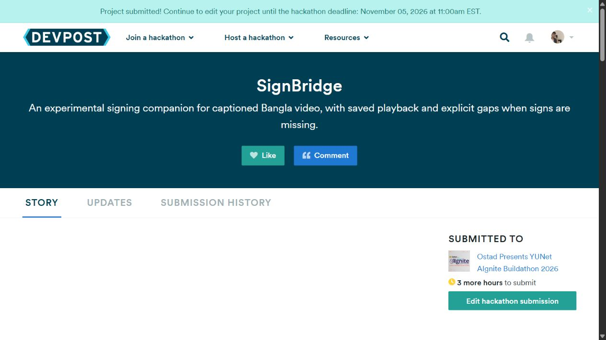

# Submission report — 5 November 2026, Asia/Dhaka

**Status: SUBMITTED — Devpost displayed “Project submitted!” and lists SignBridge under Ostad Presents YUNet AIgnite Buildathon 2026.**

[Devpost project](https://devpost.com/software/signbridge-6pw9f7) · [YouTube video, Unlisted](https://youtu.be/goRXOQeq9lQ) · [Live application](https://signbridge-sable-sigma.vercel.app) · [Public repository](https://github.com/Tayebbb/signbridge)

## Checks

| Check | Result | Evidence |
|---|---|---|
| Exact-source hosted release gate | PASS | [GitHub run](https://github.com/Tayebbb/signbridge/actions/runs/42028680928), source `65a390780459c2d2ecdf9a50b2a6516e523ff162` |
| Typecheck / lint / production build | PASS | Same hosted gate and READY production build |
| Default tests | 234 PASS, 0 fail/skip | Hosted gate |
| Native PostgreSQL tests | 53 PASS, 0 fail/skip | Hosted gate |
| Product browser checks | 22 PASS, 0 fail/skip | Chromium + Edge |
| Foundation checks | 10 PASS, 0 fail/skip | Chromium + Edge, including held-script hydration regressions |
| Complete dependency audit | 0 vulnerabilities | Patched esbuild/minimatch toolchain; full audit includes development tools |
| Actual schema loader | PASS | Disposable generated output; no database mutation |
| Public alias / database / processing | PASS | Alias resolves to tested deployment; DB ok, real processing enabled |
| Fresh staged/public upload | PASS | Blob PUT/finalize 200; eight cues, four segments, no job created |
| Saved real-avatar replay | PASS | Same manifest hash and expected ordered units; incomplete segment remains incomplete |
| Extra calls/charges for release smokes | 0 | No new stage rows or budget-ledger changes |

[Final engineering attestation](evidence/submission-2026-11-05/release/attestation.json), [hosted browser counts](evidence/submission-2026-11-05/release/hosted-summary.json), [staged check](evidence/submission-2026-11-05/release/staged.json), [public check](evidence/submission-2026-11-05/release/public.json), [health/recovery workflow](evidence/submission-2026-11-05/operations.json).

## Submission acceptance

| Requirement | Status | Evidence |
|---|---|---|
| Public app and repository | PASS | Links above; verified release pushed to main |
| Official event sticker | PASS | Owner-confirmed organizer PNG near the app’s top banner |
| At most five slides | PASS | Owner-supplied five-page PDF attached; original bytes preserved |
| English video if supplied | PASS | Owner-supplied narrated 1080p H.264/AAC video, published as Unlisted |
| Both Devpost video fields | PASS | Saved public media link and organizers’ video link |
| Required contact and project fields | PASS | Saved; private organizer contact omitted from Git |
| Event eligibility / legal acknowledgments | Owner confirmed / approved | No independent identity verification claimed |
| Final submission | PASS | Actual “Project submitted!” message and event “SUBMITTED TO” entry |

[Publication record](evidence/submission-2026-11-05/submission.json), [unchanged media hashes](../submission/file-manifest.json), [requirements](../submission/REQUIREMENTS.md), [handoff](../submission/HANDOFF.md).

## Remaining limits

The ordinary Bengali video produces nine available units, all actually played, but all four segments retain critical gaps and none is fully signed. Signing remains experimental and unreviewed. Language-correctness and user-comprehension evidence are **NONE**; physical Android/iPhone observations are **NOT RUN**. Older media counts are explicitly identified as an earlier snapshot. See [coverage and limits](COVERAGE-FOLLOWUP.md).

Combined counted verification remains **USD 0.338618**, zero outstanding reservations, under the approved USD 4 ceiling. Infrastructure uses free plans; no purchases, upgrades, billing changes or allowance increases were made. Free-plan capacity, external renderer availability and provider budgets still apply.

No blocking submission questions remain. Original phase tags/reports, immutable design, source motion and concurrent main-checkout edits are preserved.

## Description update — 5 November 2026

The Devpost pitch, public story and organizers' brief now explain the upload-and-play workflow first, define partial signing, and present the technology, verified results and remaining limits in separate sections. The YouTube description uses the same explanation with numbered instructions. GitHub's short description and README introduction are aligned.

The saved Devpost story and organizers' brief were reopened and matched to their source text; the public page displays the new pitch and story. The editor retained **SUBMITTED, 5/5 steps done**. YouTube's saved description matched all 2,941 characters, with Save disabled and visibility still Unlisted. [Publication checks and text hashes](evidence/submission-2026-11-05/description-update.json).

Published copy: [Devpost story](../submission/devpost.md), [short summaries](../submission/listing-copy.json), [YouTube description](../submission/youtube.md). This update changes public copy and repository documentation; the technical evidence above remains the basis for its claims.
