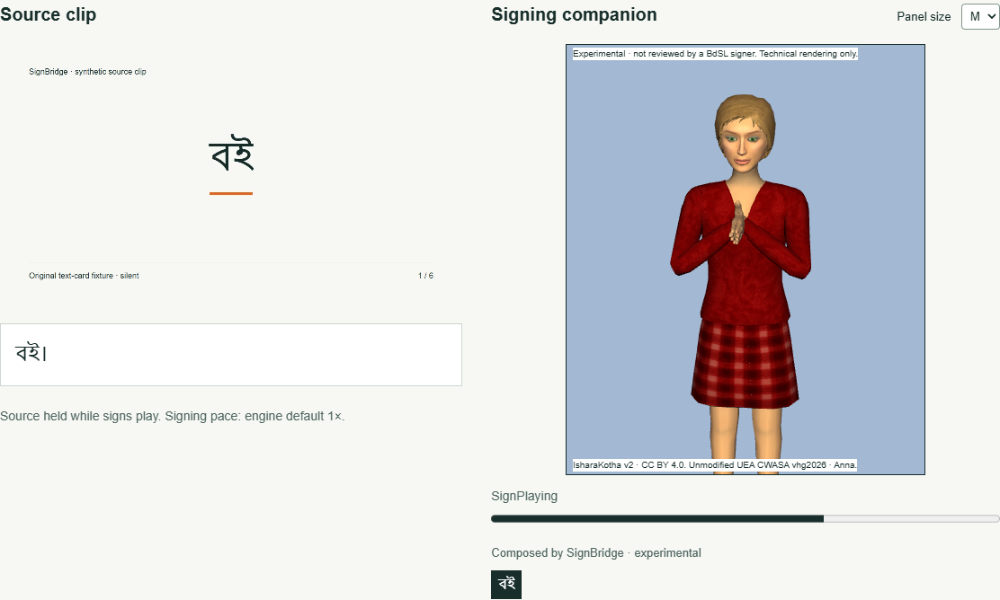
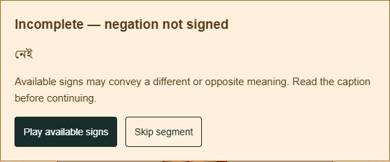

<!-- Five submission slides. Export: python scripts/export-submission-deck.py -->
# SignBridge

A signing companion that shows its gaps.

- Design target: Deaf and hard-of-hearing viewers and Bangla video creators. This audience hypothesis has not been validated with participants.
- Short captioned clips become saved, source-timed experimental signing tracks. Missing critical concepts stay visible before signing.
- Every new composition is labelled Experimental - not reviewed by a BdSL signer.

Source: SYSTEM-DESIGN.md section 0.3; phase reports 2, 5 and 7. Original synthetic demo content; no user research claimed.

---
# Follow the source, then inspect the gap




Upload captions -> validate a plan -> watch the source -> hold for signs -> replay the saved track.

Production sample A: 45 seconds, six technically ready segments, 12 model calls. Sample B deliberately leaves negation unsupported. No plan was hand-edited.

Source: phase-7 T1/T2/T14; refreshed final production captures, 4 November 2026, Windows software WebGL. Technical rendering only.

---
# Publish a durable companion track

```text
Browser -> Next.js API -> Workflow steps -> OpenAI Responses
Neon SQL: owner, epoch, stage cache, budgets, versioned manifest
Private Blob: signed source video | UEA CWASA: isolated signing iframe
```

- Propose meaning and corpus-asset steps; validate structure and critical gaps; allow one repair, then persist the result.
- Source-caption edits stop affected signing. SQL authority and epochs fence stale publishers; disposable renderer instances reject old callbacks.
- Source and avatar use separate clocks. Exact ordered unit completion counts; timeout, missing callback and skip do not count as completed signing.

Source: phase reports 3-7; T6/T7/T9/T16/T20/T22. One actual Workflow survived production cutover and published exactly one track.

---
# Keep three evidence categories separate

| Category | Current evidence |
|---|---|
| Technical renderability | 20/20 sampled corpus files in Phase 2; 12/12 curated assets in Phase 7. One Windows host, software WebGL. Six production segments replayed in Chrome and Edge. |
| Linguistic correctness | None. No qualified BdSL signer assessed these exact rendered tracks. |
| User comprehension | None. No evaluation using tasks with Deaf/BdSL users. |

Engineering checks: 194 release tests, 51 native PostgreSQL tests, 16 local browser tests; production T1/T2/T9/T14 pass. These are not language-quality scores.

SignOLight documents video-to-avatar; IsharaKotha supplies prior text-to-avatar research and corpus assets. Our tested contribution is the combination of source-frame holds, durable caption edits, saved replay and visible critical gaps. No firstness claim.

Source: phase reports 2-7 and dated phase-6/7 rechecks; SYSTEM-DESIGN.md H.3; competition-event.md prior-art audit (3 November 2026).

---
# Solo build, followed by formative evaluation

- Built as a solo project using AI coding tools. Next: consented formative sessions with qualified Deaf/BdSL reviewers, assessing exact rendered versions and critical gaps.
- Run separate comprehension tasks with Deaf/BdSL users; report participant numbers, errors and uncertainty before making outcome claims.
- Check real Android and iPhone performance. The owner supplied the official event sticker; it is used unchanged in the top banner.

Try the two public, read-only synthetic samples from the [production home page](https://signbridge-mdtayebibne-4755s-projects.vercel.app).

Source: phase-7 report; docs/MOBILE-TEST.md; SYSTEM-DESIGN.md H.3/H.6. Linguistic and comprehension evaluation are planned, not performed.
